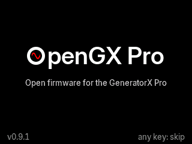
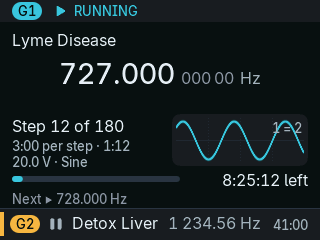
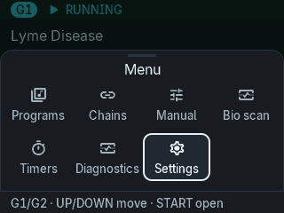

# OpenGX Pro

Open firmware for the display board of the **Spooky2 GeneratorX Pro**. It replaces the firmware of
the unit's display and keys, keeps working with Spooky2 on the PC, leaves your stored programs and
calibration alone, and can be swapped back for the original at any time.

**[polobase.github.io/opengx-pro](https://polobase.github.io/opengx-pro/)**: install it from the
browser, go back to the original, read the guide.

[](https://buymeacoffee.com/mahapo)
[](LICENSE)

  

> **Beta (0.9.1).** More than 42,000 automated checks pass, and the firmware runs on a real unit
> with Spooky2 driving both generators. Most of the checklist on the device is still to be done:
> see [Known issues](docs/guide/known-issues.md). Going back to the original takes a minute.

OpenGX Pro is an independent project. It is not affiliated with or endorsed by Spooky2; "Spooky2"
and "GeneratorX" are names of their owner. No vendor firmware, font, picture, document or capture
is in this repository or in a release. The one exception is stated: two data tables for the
built-in Terrain Protocol and the built-in preset hold frequencies, times and names taken from
Spooky2's preset files ([`docs/nx/THIRD_PARTY.md`](docs/nx/THIRD_PARTY.md)).

## What it does

- **On the screen:** the frequency, step n of N, time per step and time left, the next frequency,
  a waveform view; themes, brightness, a night view.
- **Without a PC:** the 30 stored programs as before, plus a manual generator with sweeps, chains
  and multi-day plans, timers, resume after a power cut, copy / move / erase of program slots, a
  key lock, diagnostics; with a build switch, Spooky2's biofeedback scan. Built in: the Terrain
  Protocol and the preset "Radionics (Boost)
  Manifestation" with its sweeps, with the frequencies, times and names of Spooky2's presets.
- **With Spooky2:** the same serial replies in the same order, answered in about 2 ms instead of
  about 20 ms; a PC monitor that shows what Spooky2 plays.
- **Open and checked:** every difference to the original is listed in
  [`DEVIATIONS.md`](DEVIATIONS.md) and [`docs/parity.md`](docs/parity.md).

The guide: [what it can do](docs/guide/features.md) ·
[original and OpenGX Pro side by side](docs/guide/compare.md) · [keys and screens](docs/guide/keys.md) ·
[install and restore](docs/guide/install.md) · [safety and recovery](docs/guide/safety.md) ·
[measurements](docs/guide/measurements.md) · [build from source](docs/guide/build.md).

## Install, and the way back

The easy way is the [site](https://polobase.github.io/opengx-pro/) (Chrome, Edge, Opera or Brave on
a desktop computer). By hand:

1. Power the unit off. Hold **STOP**, then press **POWER**: the screen shows "Firmware Update" (on some
   units it stays dark), the unit waits
   for an update.
2. `make release && make flash-release`, or flash a released file:
   `.venv/bin/python tools/flash_gx_pro.py -f opengx-pro-0.9.1.bin`.
3. Back to the original: `make flash-original` with your own copy of the vendor's update file
   (below), or the vendor's Windows updater.

The bootloader lives in the first 16 KB of the MCU's flash and cannot be written through the
update protocol, so the original firmware can always be restored this way. **Never change the
option bytes (read protection):** the unit is at level 1, lowering it erases the bootloader, and
there is no copy of it.

## Two firmwares

| | `APP=nx` | `APP=fw` (classic) |
|---|---|---|
| What | the new firmware: this is what OpenGX Pro releases | a re-implementation of the original firmware v7789, feature for feature |
| For | using the unit | the reference: nx is compared with it, it is compared with the original |
| Builds from | this repository alone | this repository plus **your** copy of the vendor's update file (its fonts and pictures are taken from it at build time) |
| From the vendor in it | two tables of preset data (frequencies, times, names) for the built-in Terrain Protocol and preset, committed in `src/nx/data/`; nothing else | the original's fonts and pictures |
| Released as a file | yes (`make release`) | no: it would contain the vendor's fonts and pictures |

Both share the code that talks to the PC and the generators (`src/link.c`, `src/storage.c`,
`src/runner_seq.c`, `src/core_pcmode.c`, `src/core_calmenu.c`), so the wire behaviour stays the
original's.

## Layout

| Path | Content |
|---|---|
| `src/` | what both firmwares share: hardware layer, protocols, storage, wire-level cores |
| `src/nx/` | the nx firmware; `src/nx/data/` its two tables made from Spooky2's presets; `src/classic/` the classic firmware and its test apps |
| `ld/`, `vendor/` | linker scripts; Arm and ST CMSIS headers (Apache-2.0) |
| `assets/nx/` | sources of the UI assets: font and icon pins, palettes, texts, the QR code |
| `tests/host/` | host unit tests of protocol, storage and the nx modules |
| `tests/gallery/nx/` | approved screenshots of every nx screen, compared pixel for pixel |
| `tools/` | flasher, image codec, asset tool, emulator (`tools/sim`), comparison with the original (`tools/diff.py`), device tools |
| `site/` | the web page: browser flasher, restore, guide |
| `docs/guide/` | the user guide (also on the site) |
| `docs/spec/` | how the original firmware behaves: hardware, display, protocols, application |
| `docs/nx/` | design notes, feature reference and device checklists of the nx firmware |
| `docs/hardware/` | board notes and a schematic drawn from the board |
| `original/`, `backups/` | **your** copy of the vendor files and SPI-flash dumps of your unit (never in git) |

## Build and test

- Arm GNU Toolchain 15.3.Rel1: on macOS `brew install --cask gcc-arm-embedded`.
- Python tools: `python3 -m venv .venv && .venv/bin/python -m pip install -r tools/requirements.txt`.

```sh
make release                    # the nx image as it is published -> build/release/opengx-pro-<version>.bin
make -C tests/host              # host tests
make APP=nx                     # a development build of nx -> build/nx/GxCustomFW.bin
.venv/bin/python tools/nx_gallery.py run --host && .venv/bin/python tools/nx_gallery.py compare --source host
(cd site && npm ci && npm test && npm run build)
```

Every nx build, and the released image, has the Terrain Protocol and one preset with sweeps built
in. Their tables are committed (`src/nx/data/`), so a build needs nothing from Spooky2.
`make nx-data TERRAIN_DIR=... PRESET_FILE=...` writes the tables again from your own Spooky2
installation (the two paths can stay in an untracked `local.mk`), and
`make APP=nx NX_TERRAIN=0 NX_PRESETS=0` builds without them; see
[Build from source](docs/guide/build.md).

For the classic firmware and the comparison with the original, put your copy of the vendor's
update file at `original/GxDisplayFW.bin`. It is inside the vendor's updater
`GX_Pro_Firmware_v7789.exe` (Spooky2's download page); the site's "Restore original" page and
`site/src/lib/image.ts` show how it is found there.

```sh
make                                          # APP=fw -> build/fw/GxCustomFW.bin
.venv/bin/python tools/diff.py --jobs 6       # 18 scenarios on the original and on build/fw, compared
```

More apps (`make APP=...`): `probe` (maps the serial wiring, backs up the SPI flash), `bringup`
(a test screen that never transmits), `uitest` and `linktest` (module test apps for the emulator),
`nxgallery` (the nx UI engine and screens on fixtures, for the emulator).

Everything a change must pass, and the rules that protect the device: [`CONTRIBUTING.md`](CONTRIBUTING.md).

## Tools

- `tools/emu.py` runs a build, or the original (`reference`), on an emulated board: LCD to PNG,
  keys and serial input, UART and flash-write checks.
- `tools/diff.py` / `tools/scenario.py` run the scenarios of `tools/scenarios/` on the original and
  on a build and compare screens pixel by pixel and serial traffic line by line.
- `tools/nx_gallery.py` renders every nx screen on the host and on the emulator and compares with
  the approved screenshots.
- `tools/gen_nx_assets.py` rasterises the open fonts (Inter, SIL OFL 1.1) and icons (Material
  Symbols, Apache-2.0) and builds the QR code into `src/nx/nx_assets.{c,h}`, which are committed
  (`make nx-assets`, `make nx-assets-check`); details in [`docs/nx/THIRD_PARTY.md`](docs/nx/THIRD_PARTY.md).
- `tools/gen_nx_terrain.py` and `tools/gen_nx_preset.py` make the tables of the built-in Terrain
  Protocol and preset from the preset files of a Spooky2 installation into `src/nx/data/`, which
  are committed (`make nx-data`).
- `tools/gx_link.py` with `APP=probe`: which PC channel reaches which UART, and a backup of the
  unit's SPI flash (`dump`, about 7 minutes, into `backups/`).
- `tools/latency_bench.py`, `tools/gx_latency.py`, `tools/gx_serial_test.py`: reply times and a
  catalogue of serial commands on a real unit, one run per firmware, then compared.
- `tools/pc_replay.py`, `tools/bfb_bench.py`: replay and evaluate your own serial captures of
  Spooky2 on the emulator.
- `make conformance PORT=...` runs the real-device conformance test of the
  [freqgen](https://github.com/Polobase/freqgen) `spooky2` tool against a unit.

## Support

If OpenGX Pro is useful to you: [buy me a coffee](https://buymeacoffee.com/mahapo). The same
address is on the unit as a QR code (Settings → About → Support the project).

Problems and ideas: [issues](https://github.com/Polobase/opengx-pro/issues).

## Licence

MIT, see [`LICENSE`](LICENSE). Third-party parts (CMSIS headers, the Inter fonts, Material
Symbols) keep their own licences: [`LICENSES/`](LICENSES/), [`docs/nx/THIRD_PARTY.md`](docs/nx/THIRD_PARTY.md).
The two tables in `src/nx/data/` hold preset data of Spooky2 and its preset authors. They are not
this project's own work and the MIT licence does not cover them
([`docs/nx/THIRD_PARTY.md`](docs/nx/THIRD_PARTY.md), "Spooky2 preset data").
The software comes without any warranty; flashing firmware is at your own risk.
