# nx firmware (`APP=nx`): features compared with the original

This page lists every feature of the new display firmware `APP=nx` and compares it with the
original Spooky2 GX Pro display firmware (vendor v7789). nx is the firmware of the OpenGX Pro
project (repository `opengx-pro`): an OpenGX Pro release is an nx image built with `make release`
(sections 9 and 17). `APP=fw` is our classic rebuild of the original. The nx work does not change
it: its image stays byte-identical.

State: 2026-10-13, OpenGX Pro 0.9.0 (the new name and splash, the support page; the Terrain
Protocol and the preset with sweeps built in by default from committed tables, in the released
image too, and first in menu > Chains; the released image without the vendor splash). Before
that, 2026-10-05: the PC monitor's output frequency, the built-in preset with sweeps and the
standard sine for the built-in sources; then the ghost splash, History and the 48 px digits off
by default and the PC monitor's extras reworked. Sources: `docs/spec/`, `DEVIATIONS.md`,
`docs/nx/`, the code in `src/nx/`.

## 1. Summary

- nx replaces the display firmware. The generator boards and the vendor bootloader are not changed.
- Spooky2 sees the same device: the same serial replies, byte for byte and in the same order.
- Stored programs, names and calibration keep working. You can flash the original back at any time.
- The core is faster. Replies take about 2 ms instead of 27–30 ms. Steps last exactly 1.00 s per
  second of dwell.
- The screen is new: an English UI with open fonts, a dashboard per generator, a menu, settings,
  key lock, screen dimming and resume after a power cut.
- The flows stay the original's: the "Program G1/G2" list, START, STOP, LOOP, G1, G2. A setting
  ("Original key behaviour") gives back the original's POWER, START and LOOP and its key repeat.
- Everything the original does is covered (section 8).
- Extra features, each behind its own switch: Diagnostics and a key test, timers, auto-start,
  slot copy / move / erase, a richer PC monitor, chains and multi-day plans, a manual generator
  with sweeps, a page to support the project (section 9). Off by default since 2026-10-05, to
  make room: History, the 48 px frequency digits and the original's ghost splash.
- Built in by default since 2026-10-13, in every build and in the released image: the Terrain
  Protocol and a Spooky2 preset with sweeps (sections 9.12 and 9.17), the first rows of
  menu > Chains. Their tables are generated from Spooky2's preset collection and committed
  (`src/nx/data/`). They hold frequencies, times and names that are not this project's own work
  (`docs/nx/THIRD_PARTY.md`). `NX_TERRAIN=0` / `NX_PRESETS=0` build without them. Until then
  they existed only in a personal build made with the user's own Spooky2 presets.
- The image (`make APP=nx`, and the released image of `make release`: 108,456 bytes) fits the
  112,640 bytes (110 KB) the bootloader is proven to take (size test of 2026-09-25, section 17),
  with 4,184 bytes to spare. It holds nothing from the original image, and of Spooky2's presets
  the two tables above and nothing else.

How to read the "Kind" column:

| Kind | Meaning |
|---|---|
| Same | works like the original |
| New | the original does not have it |
| Optimized | same result, faster or lighter |
| Changed | works differently from the original |
| Option | changed by default; a setting gives back the original's behaviour |
| Fixed | an original bug is corrected |
| Not included | cut for space or cancelled |

## 2. Compatibility (what stays the same)

| What | nx | Kind |
|---|---|---|
| Serial protocol with Spooky2 | The same replies, byte for byte and in the same order. The shared protocol core (`link.c`) is the one of the classic build. Every nx reply trace is one the original can also produce. | Same |
| Commands answered by the display | `:g`, `:p`, `:n` (store, `$`, `*`, `#`, `,`, `?`), `:w` maintenance numbers, `:Rev201` as the version reply. See `docs/serial-commands.md`. | Same |
| Lines sent to the generators | The idle configuration, the step lines and the PC-mode lines have the same bytes and order per link (`runner_seq.c`, proven by a host test). A program that is loaded and played in one pass (a chain's next program, a Terrain set, the manual generator) sends its idle configuration before its first step (section 9.8). | Same |
| First generator line after power-on | Not before 4.44 s, the time of the original's first main-loop pass (`NX_GEN_READY_MS`). | Same |
| PC mode (USB connected) | Entry sends `:w11=0,0,`, exit sends `:w15=0,0,`, with the same PB2 handling (`core_pcmode.c`). | Same |
| Two Spooky2 sessions opened close together | The original handles a generator's `:w91` answer only after its next 13.3 ms key scan, so the second generator's answer never reaches the PC. nx holds a pending `:w91` 15 ms after the last `:w92` of either link (`NX_W91_HOLD_MS`, `src/nx/nx_loop.c`; scenario `pc_dual_session`). | Same |
| Programs, names, calibration in the SPI flash | Same areas and formats: names at 0x05000, 30 program slots at 0x10000 + n·0x1000, calibration at 0x74000 and its backup at 0x75000. Slot copy / move / erase on the device (section 9.6) writes them as a Spooky2 upload does. | Same |
| Calibration menu | G1+G2 held while switching on. The same 29 values, the same keys, the same `:w60`/`:w61` lines. The grid repaints when the factory port or the PC changes a value. | Same |
| Factory port (USART3) | The same `:a`…`:l` commands and `Z` replies (`factory.c`). | Same |
| Power off | As the original: both generators are stopped first (idle configuration, outputs off, at most 0.3 s), then the goodbye, then the power-off signal. Not in PC mode or calibration. | Same |
| Bootloader and option bytes | Never written. Programming mode is unchanged (hold STOP, press POWER). | Same |
| Going back | `make flash-original` puts the original back. The original never touches the nx storage area. | Same |
| Vendor protection | As in the classic build: no licence check, no read-out protection change, `w91` accepted, `w00` not written (`DEVIATIONS.md`, "Policy"). | Changed |

## 3. Speed and timing

| What | Original (v7789) | nx | Kind |
|---|---|---|---|
| Reply time to Spooky2 (display commands, median) | 27–30 ms | about 2 ms (measured on the device) | Optimized |
| Main loop | blocks 13.3 ms per key scan (26.7 ms on a new press), then draws, then answers | never blocks: keys are read in an interrupt every 10 ms, the CPU sleeps (WFI) when idle, the UI draws in slices of at most 2 ms | Optimized |
| Step length | dwell × 1.01 s (its tick is 10.1 ms, not 10 ms) | exactly dwell × 1.00 s (1 ms tick) | Fixed |
| G1 and G2 lines | all G1 lines first, then G2; any link's `:ok` ends a wait | both links at the same time; each link waits for its own `:ok`; the order on each link is unchanged | Optimized |
| `:w91` after a `:w92` | handled after the next 13.3 ms key scan | held 15 ms after the last `:w92` of either link (section 2) | Same |
| Screen drawing | SPI 8-bit, polled; chip select toggles for every pixel | SPI 16-bit frames with DMA, drawn in bands of 8 lines; only changed areas are redrawn | Optimized |
| PC screen frequencies | a changed value is redrawn on every loop pass | a changed line is redrawn at most every 100 ms (always the latest value), so a fast sweep reads as a sweep | Changed |
| Boot splash | about 4.0 s | 1.2 s (full), 0.5 s (short) or off, plus 0.3 s hold; any key skips it; black in every theme (section 9.15) | Changed |
| Power off | stops both, goodbye screen, 4 s, then the power-off signal | stops both (at most 0.3 s), goodbye screen, 1.5 s, then the power-off signal; the backlight fades out in the last 0.3 s and the panel sleeps | Changed |
| USB detection (PB1) | read once per loop pass | must be stable for 15 ms | Changed |
| Program with more than 200 steps (bad upload) | plays the bytes behind the table as steps 201–255 | ends after step 200 | Fixed |

For comparison: the classic rebuild `APP=fw` answers in 22–23 ms (`DEVIATIONS.md`).

## 4. Robustness

| What | Original | nx | Kind |
|---|---|---|---|
| Watchdog | none | independent watchdog, 2 s; fed by the main loop, the SPI-flash waits and the power-off loop | New |
| Crash (HardFault, unexpected interrupt) | the CPU hangs | a crash record is kept in a RAM area that survives the reset (`.noinit`), then the MCU resets | New |
| Boot loop | – | after 3 abnormal resets in a row, each within 30 s of boot, the unit sends the power-off signal instead of resetting; a boot after such a streak runs in safe mode (no resume or auto-start offer) | New |
| Settings, resume data, chains, plans, totals | nothing is stored (only programs, names and calibration survive power-off) | a key-value log with CRC-32; the commit word is written last, so a power cut at any moment keeps the old or the new value (tested by cutting at every flash operation) | New |
| History records (with History built in, section 9.5) | – | a ring of 64-byte records, each with a sequence number and a CRC-32; a record cut by a power loss is skipped | New |
| SPI-flash writes of nx | – | its own data only in 0x080000–0x1FFFFF; every write is read back and compared; a write outside is refused and counted; foreign data in that area makes it read-only. Slot copy / move / erase writes the legacy slot and name areas (section 9.6), read back and compared | New |
| SPI-flash busy wait | can wait forever | bounded, feeds the watchdog | Fixed |
| A generator stops answering | each line waits about 30 ms, nothing is shown | after 3 timeouts in a row the link counts as down: the dashboard shows "G1 is not responding", a toast appears, the screen wakes | New |
| POWER held from power-on | a hold of about 5 s from power-on switches the unit off | a key that is already down at power-on is ignored until it is released once | Fixed |
| G2 step parameters | G2 uses G1's step index (original bug) | each generator uses its own step | Fixed |
| Dwell 0 after an upload | division by zero, undefined step | counts as 1 s | Fixed |
| Protocol and storage bugs | see `DEVIATIONS.md` | fixed in the shared code (`link.c`, `storage.c`, `calib.c`, `factory.c`, `fmt.c`), as in the classic build | Fixed |
| A line from the PC that was cut off | the value index it reached stays for the next frame, also over an `:n` frame, so the next upload is stored shifted; an index that lies past the next frame's array writes into the RAM behind it | every frame nx handles starts the next one at index 0, an `:n` frame included, so a cut-off line cannot shift the next upload; when a cut-off line left a high value index, nothing is stored past the frame's array. Only malformed lines differ (`LINK_RX_EXACT` in `src/link.c`; `DEVIATIONS.md`, "nx") | Fixed |

## 5. Display and look

| What | Original | nx | Kind |
|---|---|---|---|
| Language | English, mostly as bitmaps; only three text strings | English only, text from a string table (`assets/nx/strings/en.json`) | Changed |
| Fonts | 1-bit bitmap fonts, 24 px | Inter 13 px and 16 px, Inter Display 28 px digits (48 px digits for the dashboard only with `NX_FEAT_HERO48`, off by default), Inter Display SemiBold 40 px for the letters of the splash's wordmark (the brand font, `F_BRAND` in `assets/nx/fonts.json`); 4-bit anti-aliased (SIL OFL 1.1) | New |
| Icons | vendor bitmaps (status icons, USB, sync) | Material Symbols Rounded (Apache 2.0) and own icons | New |
| Logos | Spooky2 logos, QR code, web address | the splash: a drawn one (the wordmark "OpenGX Pro" in a brand font, its "O" a ring with a red sine; section 9.15); the original's Spooky2 ghost artwork only in a personal build made with `NX_VENDOR=1` from the user's own original image (section 9.10), never in the released image. The splash and the goodbye have no QR code or web address; Settings > About > "Support the project" shows a QR code of `https://buymeacoffee.com/mahapo` with the address in words (section 9.16) | Changed |
| Colours | teal, grey, white, black, yellow, red | themes Dark (default), Light and High contrast, plus a night palette; G1 cyan #38C7DA, G2 amber #F5B544; text contrast at least 4.5:1, other UI at least 3:1 (checked by the asset tool); a state is always icon plus text. The splash stays black in every theme, as the original's | New |
| Orientation | panel in portrait mode, every bitmap pre-rotated in software | the panel's own landscape mode (MADCTL 0xA0, checked on the unit) | Changed |
| Panel init | variant A/B command lists | the same lists, then 16-bit SPI and landscape | Same |
| Backlight | software PWM, 16 steps, 625 Hz, fixed at 50 % | PWM on TIM17, 1 kHz, 256 levels with gamma 2, smooth fades; brightness 10–100 % | New |
| `:w64` (PC switches the display on/off) | on / off | same meaning; "on" uses the user's brightness and also wakes a screen nx has switched off; the goodbye is lit even after `w64` off, as the original's | Same |
| Dim and screen off | the screen is always on | dims to a third after "Dim after", then fades off and the panel sleeps after "Screen off after"; POWER short switches the screen off and on. The PC monitor stays lit, as the original's PC screen | New |
| Wake on events | – | a finished program, a timer stop, the power-off countdown, a generator that stops answering, PC mode in or out, `w64` on, the calibration menu wake the screen | New |
| Animations | none (only the name marquee) | screen push (hardware scroll), sheet reveal, toast slide, backlight dip for PC mode in/out, list selection glide and scroll, odometer roll of changing digits, moving scope trace, splash and goodbye rings; "Reduce motion" turns motion down | New |
| Long program names | scroll (marquee) | scroll; can be switched off | Same |
| Characters in names | 86-glyph font; unknown bytes are skipped | printable ASCII; other bytes show as "?" | Changed |
| PB7 output | 16-step PWM, 625 Hz | unchanged | Same |

## 6. Keys

A key acts when pressed. If it also has a "hold" meaning, a short press acts on release (within
0.5 s). Full details: `docs/nx/key-model.md`.

| Key | Original | nx | Kind |
|---|---|---|---|
| START | channel screen: play / pause (START clears the loop flag); list: load | dashboard: play, pause, resume, after the end play again; keeps the repeat setting (with "Original key behaviour": clears it, as the original); no program: opens the program list; list: load and show that generator | Option |
| STOP | stop the shown generator (back to step 1, outputs off, loop cleared); list: back without loading | short: stop the focused generator; held 1 s, then released: stop both (a ring shows from 0.5 s); list: back without loading; STOP is "back" everywhere | Changed |
| LOOP | stopped: play with loop; running: pause and set loop | running: repeat on/off only (nothing is sent; with "Original key behaviour": pause with repeat on, as the original); stopped or paused: play with repeat; held: program detail (the manual generator: its screen); in the program detail: slot actions (section 9.6) | Option |
| G1 / G2 | open that generator's screen; the one already shown, or one without a program: its program list; in the list: switch the target | the same flow; the screen slides | Same |
| UP / DOWN | list: move (repeat after about 0.28 s, then about every 26 ms); calibration: select a value | list: move (repeat speed is a setting; "Original key behaviour": 280 ms, then 26 ms); dashboard: UP quick settings, DOWN the menu; PC mode: brightness | Changed |
| POWER short | stop both generators | screen off / on (the first key after "off" only wakes); with "Original key behaviour": stop both on the dashboard, as the original | Option |
| POWER held 0.8 s | stop both, power off | stop both, power off; a ring shows from 0.2 s; works also when the keys are locked | Same |
| G1+G2 held 1.5 s | – | lock the keys (lock icon in the status bar) | New |
| START+STOP held 1.5 s | – | unlock the keys | New |
| Keys in PC mode | ignored (except power off) | START, STOP, LOOP do nothing; UP/DOWN set the brightness; POWER as everywhere | Changed |
| A key held while PC mode starts or ends | ignored in the pass that enters or leaves PC mode | does nothing on the next screen: its hold and its release are ignored until it is released once. POWER keeps its meaning (`modes()` in `src/nx/nx_ui.c`) | Same |
| G1+G2 held while switching on | calibration menu | calibration menu | Same |
| STOP held, then POWER (unit off) | bootloader programming mode | the same (bootloader untouched) | Same |

## 7. Screens

| Original screen | nx screen | Kind |
|---|---|---|
| Boot splash: vendor logos, "Welcome to Spooky2", about 4 s | on black in every theme: a drawn splash (the wordmark "OpenGX Pro" whose "O" is an animated ring with a red sine in it, the line "Open firmware for the GeneratorX Pro", at the foot "v0.9.0" and "any key: skip"), or the original's ghost artwork fading in (a personal build with `NX_VENDOR=1`); full, short or off; any key skips | Changed |
| HOME: two grey panels "Choose Your Treatment Program" | dashboard without a program: "No program loaded", "START or G1 again: choose a program", "DOWN: Menu · UP: Quick settings"; the other generator in the strip | Changed |
| Channel screen CH1/CH2: active panel white, the other grey; name; status icon (ready / running / paused / stopped); frequency only while running; loop badge | dashboard: the focused generator large, the other one as a strip at the bottom with its own loop badge. Status bar (G badge, state with the original's icons: READY with a check, RUNNING, PAUSED, STOPPED with a stop icon after STOP; LOOP ×N; minutes of a "stop after" timer; "Chain 2/5", or "Day 3/11" for a plan or the Terrain Protocol; lock). Name (marquee). Big frequency with dimmed trailing zeros. Step n of N, time per step and time left in the step, amplitude and waveform. Live scope. Progress bar with time left or total. Next frequency. Loop pass counter. The frequency also shows when ready or paused. | Changed |
| – | dashboard states: ready, stopped, running, paused, finished ("Program complete" card), not responding (warning card) | New |
| Program list "Program  G1/G2": 7 rows "NN. name", teal selection bar, 30 slots, selection and window kept | "Program" + G1/G2 badge; 7 rows "NN. name" in a framed box; the selected row is a bar in the generator's colour; a slot without a name shows "Slot NN"; an empty slot loads the empty program; long names scroll; the selection and the window are kept | Same |
| – | program detail (LOOP held in the list or on the dashboard): name, "Run on G1/G2", summary (steps, time per step, waveform, volts), all step frequencies, the playing step marked; START loads and plays; LOOP opens the slot actions | New |
| PC screen: both panels, PC icon, Out1/Out2 frequencies (up to 8 decimals), sync icon, the names of slots 0 and 31 scroll in turn | PC monitor: "PC MODE" with a USB icon; per generator its name (slots 0 and 31, scrolling in turn), the waveforms of Out1 and Out2 and "gated" at the end of the name line, the amplitude under "OUT 1" / "OUT 2" (section 9.7), OUT 1 / OUT 2 frequencies with up to 8 decimals (a smaller font when the big digits do not fit) and on/off dots, a synced Out2 shows Out1's value with "= OUT 1"; with a wave table of several cycles the output frequency and the cycles, "396.00 Hz ×11" (section 9.7); stays lit; never sends anything | Changed |
| Calibration: 29 numbers, selected value inverted, repainted when the factory port or the PC sets a value | the same grid positions, small index labels, selected cell highlighted; a factory-jig value marks its cell; repainted when the factory port (`:c`) or the PC (`w60`/`w62`/`w63`/`w80`) changes a value | Same |
| Goodbye: QR code, logos, "Looking forward to seeing you again!", web address, 4 s | power icon, a closing ring, "Goodbye", 1.5 s, backlight fade, panel sleep | Changed |
| – | quick settings sheet (UP) | New |
| – | menu sheet (DOWN): Programs, Chains, Manual, Timers, Diagnostics, Settings (and History when it is built in) | New |
| – | Settings: Display, Keys & lock, Motion, About, Reset all settings | New |
| – | Support the project (Settings > About): a QR code and the address in words (section 9.16) | New |
| – | Timers page (menu > Timers) | New |
| – | History (menu > History), off by default (section 9.5) | New |
| – | Diagnostics and key test (menu > Diagnostics) | New |
| – | Chains list (the Terrain protocols and the built-in preset first, then the chains and the plans), chain editor, plan editor (menu > Chains) | New |
| – | Terrain screen (menu > Chains > a Terrain row, LOOP; section 9.12) | New |
| – | manual generator (menu > Manual, or LOOP held on its dashboard) | New |
| – | set-end card "Set finished · safe to pause" (a Terrain Contact session; section 9.13) | New |
| – | slot actions sheet (program detail > LOOP), target list "Copy NN to" / "Move NN to", "Erase this program?" | New |
| – | "Resume after power cut?" card with a 15 s ring | New |
| – | "Start the last programs?" card with a 10 s ring (auto-start) | New |
| – | "All programs finished · Powering off" card with a 15 s ring | New |
| – | key-lock card ("Keys locked · Hold START+STOP to unlock") | New |
| – | hold rings: "Keep holding to switch off", "Hold: stop both" | New |
| – | toasts (4 s): memory error, generator does not respond, keys locked / unlocked, brightness in PC mode, factory value, stops and loads, timer stops, slot operations, chains, plans and the Terrain Protocol started | New |

The texts and details that came back after the size cut are listed in section 15.

### Waveform names

The dashboard and the program detail name the waveform of the program header.

| Code | Shown as |
|---|---|
| 0 (empty program) | flat line |
| 11–19 (Spooky2 waves 1–9) | Sine, Square, Sawtooth, Inverse sawtooth, Triangle, Damped sine, Damped square, H-Bomb sine, H-Bomb square |
| 25 | Inverted (Out2 is the inverse of Out1) |
| anything else, e.g. 41–70 | "wave #N ?" and a sine as a stand-in |

Spooky2 stores each uploaded program with waveform table 40 + slot (slot 7 → table 47) in the
generator boards. The display cannot see the shape of that table, so it shows the number with "?".
The PC monitor uses the same names for the waveforms the PC sets; a number it does not know shows
as "#N" (20 and 21 are Spooky2's two user-defined shapes). Tables 18 and 19 are Spooky2's
`Sine_Hbomb` and `Square_Hbomb`: until 2026-10-05 nx called them "H-Bomb edge" and "H-Bomb sine";
serial captures of Spooky2 show a table of sine cycles and one of square cycles. The manual generator (section 9.14) and the Terrain sets (section 9.12) play the tables
11–19, so their waveform always has a name.

## 8. Coverage of the original

Everything the original display firmware does, and how nx covers it.

| The original | nx | Kind |
|---|---|---|
| Boot splash with the Spooky2 ghost, "Welcome to Spooky2" and the tagline | a drawn splash (the wordmark "OpenGX Pro"); the same artwork at the same places, fading in, only in a personal build made with `NX_VENDOR=1` from the user's original image; black in every theme, as the original's | Changed |
| HOME screen: choose a program | dashboard without a program, with the same keys to choose one | Changed |
| Program list: 30 slots, 7 rows "NN. name", UP/DOWN, G1/G2 target, START loads, STOP back without loading | the same flow and rows | Same |
| The list keeps its selection and its window (`list_top`) | kept, for both generators | Same |
| One screen per generator, the other one grey | the focused generator large, the other in the strip | Changed |
| Status: ready (check icon), running, paused, stopped (stop icon) | READY with the check icon, RUNNING, PAUSED, STOPPED with the stop icon after STOP. At the end nx shows FINISHED and the "Program complete" card | Same |
| The loop badge of both generators | the focused one in the status bar, the other one in the strip | Same |
| START: play / pause, the loop flag cleared | play / pause, repeat kept; "Original key behaviour": cleared | Option |
| LOOP: stopped: play with loop; running: pause with loop on | stopped or paused: play with repeat; running: repeat on/off; "Original key behaviour": pause with repeat on | Option |
| STOP: stop the shown generator | the same; held 1 s: both | Same |
| POWER short: stop both | screen off / on; "Original key behaviour": stop both on the dashboard | Option |
| POWER held: stop both, goodbye, power off | the same order: both stopped (outputs off, at most 0.3 s), goodbye 1.5 s, power off | Same |
| Key repeat in the list and the calibration menu: after about 0.28 s, then about every 26 ms | Slow / Normal / Fast; "Original key behaviour": 280 ms, then 26 ms | Option |
| Long names scroll | the same (can be switched off) | Same |
| PC screen: the names of slots 0 and 31 take turns scrolling | the same | Same |
| PC screen: frequencies with up to 8 decimals | the same (a smaller font when the big digits do not fit) | Same |
| PC screen: a synced Out2 shows Out1's value | the same, with "= OUT 1" | Same |
| PC screen: an output on or off (teal / grey) | a filled dot / a ring, the value dimmed when off | Same |
| PC screen: always lit | the PC monitor stays lit | Same |
| PC screen: a changed frequency redrawn on every loop pass | at most every 100 ms | Changed |
| PC mode: keys do nothing except power off | START, STOP, LOOP do nothing; UP/DOWN brightness; POWER as everywhere | Changed |
| A key is ignored in the pass that enters or leaves PC mode | a key held while PC mode starts or ends does nothing on the next screen | Same |
| `w64`: the PC switches the display off / on | the same; "on" also wakes a screen nx switched off; the goodbye is lit after `w64` off | Same |
| Two Spooky2 sessions close together: the second `:w91` answer never reaches the PC | the same (15 ms hold) | Same |
| Calibration menu: G1+G2 at power-on, 29 values, keys, lines | the same | Same |
| Calibration grid repainted when the factory port (`:c`) or the PC (`w60`/`w62`/`w63`/`w80`) sets a value | the same | Same |
| Factory port | the same | Same |
| Serial protocol, program / name / calibration storage | the same | Same |
| Goodbye: QR code, logos, 4 s | power icon, ring, "Goodbye", session time, 1.5 s | Changed |
| Bootloader programming mode | the same | Same |

## 9. Features beyond the original

Each feature can be switched off in `src/nx/nx_config.h` (`NX_FEAT_*`) to fit a smaller proven
image size. Switching one off removes its code and its menu cell; its strings and icons stay in
the asset tables. Off by default since 2026-10-05, to make room for other work
(`docs/nx/drop1-size-inventory.md`): History (`NX_FEAT_HIST`), the 48 px frequency digits
(`NX_FEAT_HERO48`) and the ghost splash (`NX_VENDOR`). `make APP=nx NX_LCD_OPTS=-DNX_FEAT_HIST=1`
(or `NX_VENDOR=1`) builds one in again, in a personal build. Measured on 2026-10-06 in a build
with the Terrain data and the preset (106,538 bytes then; not measured again since): any two
of them fit; all three together are 112,930 bytes, 290 over the budget. The image of 2026-10-13
is 108,456 bytes and leaves 4,184. By the three costs measured then (2,264, 2,120 and 2,008
bytes) each still fits on its own, History and the 48 px digits together come to 4,128 bytes,
and a pair with the ghost splash no longer fits. Not measured on this image.

Released image and personal build. `make release` builds the image that is published (an
OpenGX Pro release, `build/release/opengx-pro-<version>.bin`). It is built from scratch with
the default switches: with the Terrain Protocol (section 9.12) and the preset with sweeps
(section 9.17) from the committed tables in `src/nx/data/`, and without the vendor splash, so
nothing from the original image is in it. The Makefile refuses a release build with `NX_VENDOR`
on, with `NX_TERRAIN` or `NX_PRESETS` off, or with `NX_TIME_X` or `NX_LCD_OPTS` set;
`NX_RELEASE` in `src/nx/nx_config.h` stops the compiler on the first three; and
`tools/release_check.py` checks the finished build again (flags, map file, build directory,
size, update file).

The two tables (since 2026-10-13). `tools/gen_nx_terrain.py` and `tools/gen_nx_preset.py`
generate them from Spooky2's preset collection; they are committed, so every build has the same
ones and needs no Spooky2 installation. `make nx-data TERRAIN_DIR=... PRESET_FILE=...` writes
them again from a Spooky2 installation (the two variables can stay in an untracked `local.mk`,
which the Makefile includes; a normal build does not use them). `make APP=nx NX_TERRAIN=0`
builds without the Terrain rows, `NX_PRESETS=0` without the preset row. The tables hold
frequencies, times and names taken from Spooky2's preset files: they are not this project's own
work and the project does not claim them (`docs/nx/THIRD_PARTY.md`). Until 2026-10-13 they were
made at build time into `build/` from the user's own presets, never committed, and a release was
built without them.

Still only in a personal build, one you make for your own unit: History and the 48 px digits
(switched on with `NX_LCD_OPTS`), and the ghost splash (section 9.10; `NX_VENDOR=1`, needs your
own copy of the original image and is never in a release).

| Feature | Where | Switch | Stored |
|---|---|---|---|
| Menu grid | DOWN on the dashboard | – (its cells follow the switches below) | – |
| Diagnostics and key test | menu > Diagnostics | `NX_FEAT_DIAG` | – |
| Timers: stop after, power off when all finished | menu > Timers | `NX_FEAT_TIMERS` | settings record (KV key 0x0001) |
| Auto-start at power-on | menu > Timers | `NX_FEAT_TIMERS` | KV key 0x0003, the setting in key 0x0001 |
| History and totals (off by default) | menu > History | `NX_FEAT_HIST` | ring at 0x0A0000, totals in KV key 0x0005 |
| Slot copy / move / erase, play on G1 and G2 | program detail > LOOP | `NX_FEAT_SLOTS` | the legacy program and name areas |
| PC monitor: waveforms, amplitudes, gating, the output frequency of a table with several cycles | PC monitor | – (a fixed part since 2026-10-05) | – (RAM, per PC session) |
| Chains | menu > Chains | `NX_FEAT_CHAINS` | KV key 0x0004 |
| Multi-day plans | menu > Chains | `NX_FEAT_PLANS` (follows `NX_FEAT_CHAINS`) | KV key 0x0006 |
| Terrain Protocol | menu > Chains, the first rows | `NX_FEAT_TERRAIN` (follows `NX_FEAT_CHAINS`); its data: Makefile `NX_TERRAIN` (on by default: the committed table `src/nx/data/nx_terrain_data.c`; `NX_TERRAIN=0` builds without it; on in the released image) | KV key 0x0007 |
| Manual generator and sweeps | menu > Manual | `NX_FEAT_MANUAL` | KV key 0x0008 |
| Presets with sweeps | menu > Chains, after the Terrain protocols | `NX_FEAT_PRESET` (follows `NX_FEAT_CHAINS`); its data: Makefile `NX_PRESETS` (on by default: the committed table `src/nx/data/nx_preset_data.c`; `NX_PRESETS=0` builds without it; on in the released image) | – (the resume snapshot, as any program) |
| The original's ghost splash (off by default; a personal build only) | splash | Makefile `NX_VENDOR=1` (needs `original/GxDisplayFW.bin`) | – |
| Support the project | Settings > About | `NX_FEAT_SUPPORT` | – |
| 48 px frequency digits (off by default) | dashboard | `NX_FEAT_HERO48` | – |
| Original key behaviour | Settings > Keys & lock | – | UI settings (KV key 0x0001) |

The records of these features are written only when no running step ends within 100 ms (a whole
quiet second before a sector erase or a compaction of the KV log) and never in PC mode; the
settings as in section 11.

Program sources (`src/nx/nx_src.h`): a generator's `g_ch[].prog_slot` names what it plays. 1–30 is
a stored slot, `NX_SRC_PRESET` + n (0x30 + n) is built-in preset n, `NX_SRC_SET` + n (0x40 + n)
is built-in Terrain set n, `NX_SRC_MANUAL` (0x3F) is the manual generator. Loading one of them
fills `g_ch[].prog` as `program_load` fills it for a slot (waveform table, amplitude, offset, step
count, frequencies, no gating), so the runner sends the same lines. Only the step times differ: a
set and a preset have a dwell per step, the manual generator has one step without an end. A
preset adds lines of its own before its first step (section 9.17). No serial command of the
display is new: Spooky2 sees nothing of this.

### 9.1 Menu (DOWN)

| Part | How it works |
|---|---|
| Opens | DOWN on the dashboard: a sheet with a grid of 4 columns and 2 rows (3 columns when a build has 6 items or fewer) |
| Cells | Programs, Chains, Manual in the first row; Timers, Diagnostics, Settings in the second (3 columns for 6 cells or fewer). With History built in: 4 columns, History before Diagnostics. A cell whose feature is switched off is left out |
| Keys | G1/G2 move along a row, UP/DOWN change the row (both wrap; on the shorter row the same column, or its last cell); START opens; STOP closes |
| Programs | the program list of the focused generator |
| Selection | at power-on on Settings, then on the item used last (START or STOP) |
| Code | `src/nx/nx_scr_sheets.c` |

### 9.2 Diagnostics and key test (`NX_FEAT_DIAG`)

| Part | How it works |
|---|---|
| Rows | Firmware (version · panel), Uptime (h:mm:ss · boot count of the RAM crash record), Last reset (Power on, Reset pin, Software, Watchdog, Fault; faults; "safe mode"), G1 link and G2 link (a green or red dot · lines sent · errors · average `:ok` time), PC mode ("N in · N out · N w91 held"), SPI flash (JEDEC ID · the nx store "empty" or "read-only" when so · KB free in the KV log · errors), Main loop (longest gap), MCU (temperature °C · supply V · "not calibrated") |
| Updates | once a second; START reads the values now |
| Keys | UP/DOWN scroll, LOOP key test, START refresh, STOP back |
| Counters | since the last boot; "w91 held" counts the `:w91` lines held after a `:w92` (section 2) |
| MCU sensors | the MCU's temperature sensor and VREFINT, read by the ADC, with the chip's factory calibration (30 °C, 3.0 V) and the datasheet slope (2.5 mV/°C); not checked against a thermometer; "-" when the ADC does not answer (`src/nx/nx_hw.c`, `nx_diag_sensors` in `src/nx/nx_diag.c`) |
| Key test | the 8 keys as caps that light while held; the last key event as text ("pressed", "released after N ms", "held", "held long", "together"); the keys act on nothing; STOP held 1.5 s leaves; POWER held 0.8 s still switches off; the screen stays lit |
| Code | `src/nx/nx_scr_diag.c` |

### 9.3 Timers (`NX_FEAT_TIMERS`)

| Part | How it works |
|---|---|
| Where | menu > Timers (a page of the settings screen): "G1 stops after", "G2 stops after", "Power off when all finished", "Start last programs at boot" (section 9.4) |
| Stop after | Off, 5, 15, 30, 45, 60, 90, 120, 180, 240 min of running time per generator. Paused time does not count; a stop, the end, an empty generator or a changed value starts the count again; a chain counts as one run |
| While it counts | the status bar shows a timer icon and the minutes left (rounded up) |
| When it is reached | the generator stops as with STOP; toast "G1 stopped after 30 min"; the screen wakes; a chain ends; History records "timer" |
| Power off when all finished | once a program has ended by itself or by its timer and no generator runs or is paused: the card "All programs finished · Powering off · any key cancels" with a ring that fills in 15 s, then the normal power-off. Any key cancels (a short POWER press too; POWER held switches off as everywhere). A program that starts again removes the card; no card in PC mode or between two programs of a chain |
| Not counted | in PC mode, in calibration, in the first 4.4 s |
| Stored | `session_limit_min` and `off_when_done` in the settings record (KV key 0x0001); "Reset all settings" sets them to off |
| Code | `src/nx/nx_timer.c`, `src/nx/nx_scr_set.c`, `src/nx/nx_ui.c` |

### 9.4 Auto-start at power-on (`NX_FEAT_TIMERS`)

| Part | How it works |
|---|---|
| Setting | menu > Timers > "Start last programs at boot", default off |
| What is kept | while the setting is on: the slot (or Terrain set) and the repeat flag each generator last started (KV key 0x0003); not the manual generator |
| The offer | after the splash, on the dashboard: "Start the last programs?" with a ring that fills in 10 s |
| Keys | START starts now; STOP cancels; a full ring starts; other keys do nothing (POWER works) |
| Result | each kept slot is loaded and plays from step 1, with its repeat flag; a chain or plan is not restarted, only its last program; a Terrain protocol goes on from its stored position (the protocol that generator played last) |
| Offered only | after a power-on or reset-pin boot, with USB not connected (PB1 low), no key held except POWER, not in safe mode, and when there is nothing to resume (a resume offer wins) |
| Code | `src/nx/nx_resume.c` (`auto_boot`) |

### 9.5 History and totals (`NX_FEAT_HIST`)

| Part | How it works |
|---|---|
| State | off by default since 2026-10-05 (2,120 bytes): no History cell in the menu and nothing is recorded. `make APP=nx NX_LCD_OPTS=-DNX_FEAT_HIST=1` builds it in again; the records and totals already in the SPI flash stay where they are meanwhile. The host tests keep it on (`tests/host/Makefile`) |
| What is recorded | every run of 5 s or more: slot and its name at the time, generator, running time (paused time not), the uptime at its start, the session (a boot in which something was played), and how it ended |
| Ends | finished, stopped (STOP, another program, switched off with POWER held), timer, PC mode, power cut. Each program of a chain is a run of its own; so is each Terrain set (a Remote set is "finished" when its hours are done) and each run of the manual generator (named "Manual") |
| Power-off | at a clean power-off the playing runs end as "stopped" and the records still waiting in RAM are written (not in PC mode) |
| Power cut | the resume snapshot found at the next boot becomes a "power cut" record (so only with "Resume after power cut" on); its time is the program position of the last snapshot, its start "+0:00" |
| Where | a ring at 0x0A0000: 32 sectors of 64 records of 64 bytes (2,048); the oldest sector is erased when the ring comes round. Totals (all-time running time, runs, runs per slot, sessions) in KV key 0x0005 |
| Writing | records wait in RAM (up to 4) and are written like the settings: never in PC mode, only when quiet. Each record has a sequence number and a CRC-32, so a torn record is skipped |
| Screen | menu > History: the title shows the total running time and runs; below, newest first, two lines per run: "NN  name", then "G1 · 45:00 · finished · session 14 +1:05" (finished in green). "Nothing played yet" when empty |
| Keys | UP/DOWN scroll, STOP back |
| No clock | the unit has no real-time clock: a run shows its session and the uptime at its start, not a date |
| Code | `src/nx/nx_hist.c`, `src/nx/nx_scr_hist.c` |

### 9.6 Slot copy / move / erase, play on G1 and G2 (`NX_FEAT_SLOTS`)

| Part | How it works |
|---|---|
| Where | program detail > LOOP: a sheet "Program NN" with "Play on G1 and G2", "Copy to another slot", "Move to another slot", "Erase" |
| Play on G1 and G2 | loads the slot on both generators, plays both from step 1, shows the dashboard |
| Copy, move | the program list "Copy NN to" / "Move NN to" opens on the first empty slot after the source; START picks the target; STOP goes back |
| Erase | "Erase this program?": hold START 1 s to erase, STOP cancels |
| The writes | those of a Spooky2 upload: the target's program sector erased and written (record and gating pairs) in 256-byte pieces, each read back and compared; the name table rewritten. A move copies, then erases the source |
| When | queued; run from the main loop when no running step ends within a second (1.5 s for a move; a sector erase can take 400 ms); never in PC mode. A waiting request is dropped when PC mode starts, and after 10 s without such a quiet moment ("Not done: the programs never paused long enough") |
| Toasts | "Copied to NN", "Moved to NN", "Program NN erased"; "Could not write the SPI flash" on a failure |
| Refused | a target that holds a program ("That slot is not empty: erase it first"); a slot a generator has loaded (copy: the target; move: either; erase: the slot: "A generator has that program loaded"); another request still waiting ("Wait: the last request is not done yet"); an empty source ("That program slot is empty") |
| Code | `src/nx/nx_slots.c`, `src/nx/nx_scr_lib.c` |

### 9.7 PC monitor: waveforms, amplitudes, gating, output frequency

| Part | How it works |
|---|---|
| What it shows | what the PC set, per output. At the end of each generator's name line: Out1's waveform (a name, or "#N"), then " / " and Out2's when it is another one, then "gated": "Sine / Inverted", "Square / Inverse sawtooth · gated" (at most 168 px; a longer text ends in "…", the name scrolls in the rest). Under "OUT 1" and "OUT 2": that output's amplitude, "20.0 V". Since 2026-10-05; before, only Out1's waveform and amplitude showed, on the name line |
| Source | a parser in the receive interrupt reads `:w20`/`:w21` (waveform), `:w28`/`:w29` (amplitude, 0.01 V) and `:w12` (gating on when its first value is not 0) from the bytes of both links. It only reads: `link.c` and the replies are unchanged |
| Amplitude | the value the PC sent: the peak-to-peak voltage of that output (Spooky2's guide: "A" is "the peak to peak voltage", 20 V at most), and what Spooky2's own "Generator Output" pane shows. It can be lower than the preset's Amplitude setting. With an offset only part of the −10 … +10 V range is left: the guide's table gives 10 V peak to peak for "20 V" at 100 %, and in serial captures of Spooky2 its Radionics presets go out as `:w28=1000,`. Spooky2 also lowers it below the "Reduce Amplitude" frequency, with a positive-only waveform and in a ramp. So the monitor shows "10.0 V" for that preset. On 2026-10-05 nx showed wire × (100 + offset %) / 100 for a day ("20.0 V"): that rule was wrong (a 10 V preset at 100 % also goes out as 10.00 V and would have shown 20 V) and is gone; the dashboard shows the program header's amplitude again |
| Output frequency | with a Wave Cycle Multiplier Spooky2 puts several cycles into one wave table and sends the frequency divided by their number (its help: "Wave Cycle Multipliers cause the generator to display a different frequency"). The monitor shows the wire value times the cycles of the table `:w20` / `:w21` selected, rounded to 6 decimals, and the cycles after "Hz": "396.00 Hz ×11". A synced Out2 shows Out1's value and "= OUT 1". The original shows the wire value, 36.00 Hz (found with a serial capture of Spooky2 of 2026-10-05, `tools/pc_replay.py`) |
| Cycles of a table | the same parser reads the table uploads (`:aNN=` and 1024 samples of 0–1023, tables 11–26) and looks at a table's upward crossings of 512, the gap around the table's end too. Evenly spaced ones (2 to 180, the gaps within 2 samples of each other) are its cycles: sine, square, the damped shapes. Three or more (up to 64) that all lie on one grid of c steps are c cycles: Spooky2's H-Bomb tables are 16 cycle slots, 4 flat, one full cycle, 6 small ones, one full cycle, 4 flat, so 8 crossings 64 samples apart and a gap of 576 (since 2026-10-05; they showed the wire value before). Anything else is one cycle. Of the 13 tables Spooky2 uploads for the Radionics preset: the sine, the square, the two damped ones and the inverse ×11; the two H-Bomb tables ×16; sawtooth, triangle, the user tables and the flat one ×1. Without an upload this session the wire value shows, as before. The count is made at the table's last byte, in the receive interrupt: at most 64 gaps, three passes (the longest handler in the replay of that capture: 86 µs of emulator time). `tools/pc_replay.py replay` compares the firmware's count for every table of a capture and prints that time |
| Layout | the big digits only when they, "Hz" and the note behind it end at the margin ("= OUT 1" ran off the screen behind a wide number). The amplitude sits under the output's label, so it takes nothing from the frequency |
| Reading | the four frequencies are read with the interrupts masked: the receive interrupt writes them, and a code of 2^32 or more (Spooky2 sends up to 12 digits) could show half old, half new for one redraw |
| Session | cleared at each PC-mode entry: a new session shows only its own values |
| Redraw | a changed frequency line is redrawn at most every 100 ms (the whole PC monitor, not only this feature) |
| Code | `nx_rx_tap` and `tab_cycles` in `src/nx/nx_diag.c`, `nx_fmt_pc_freq` in `src/nx/nx_uifmt.c`, `src/nx/nx_scr_pc.c` |

### 9.8 Chains (`NX_FEAT_CHAINS`)

| Part | How it works |
|---|---|
| What | up to 4 chains of up to 12 program slots, with a repeat count ×1, ×2, ×3, ×5, ×10 or "until stopped" |
| List | menu > Chains, one list of six rows at a time. Since 2026-10-13 the built-in programmes stand first: the Terrain protocols (section 9.12), then the built-in preset (section 9.17), then "Chain 1"…"Chain 4" ("3 programs · ×2", or "empty · LOOP to edit"), then the plans; the list opens on its first row, the first Terrain protocol (before: chains, plans, preset, Terrain). A build without a table has no rows of that kind. The title shows the generator it plays on ("Run on G1 G2"); a play icon marks a chain that plays |
| List keys | UP/DOWN select, G1/G2 the generator, START plays (an empty chain opens the editor), LOOP edits, STOP back |
| Playing | each program is loaded and played (repeat off) as the keys would do; when it ends by itself the next one starts; after the last one the chain starts again until it has run its repeat count. Toast "Chain 1 on G1"; the status bar shows "Chain 2/5" |
| Waveform and amplitude | each program plays with its own: the runner sends the new program's idle configuration (waveform table `w20`/`w21`, amplitude `w28`/`w29`, offset) before its first step (`nx_runner_loaded`, called from `NXA_LOAD`). Fixed on 2026-09-25: before, a chain switched programs without sending them, so the generator kept the last program's waveform and amplitude. Slot playback through the keys is unchanged (runner differential test, emulator gates) |
| Ends | STOP, another program, its "stop after" timer, PC mode |
| Editor | "Chain 1 · ×2": rows "1. 05 name", then "Add a program". G1/G2 change the selected slot (1–30), START adds a copy of the selected one after it, START held removes it, LOOP steps the repeat count, STOP saves and goes back |
| Resume | the resume snapshot keeps the chain position, so a resumed program goes on with its chain (if the chain did not change) |
| Stored | KV key 0x0004, written when quiet, never in PC mode |
| Code | `src/nx/nx_chain.c`, `src/nx/nx_scr_chain.c` |

### 9.9 Multi-day plans (`NX_FEAT_PLANS`)

| Part | How it works |
|---|---|
| What | 2 plans of up to 14 days, a chain per day |
| List | below the chains in menu > Chains: "Plan 1" with "5 days · day 3", "complete · LOOP to restart" or "empty · LOOP to edit" |
| Playing | START plays the current day's chain on the chosen generator (toast "Plan 1: day 3"); the status bar shows "Day 3/11". An empty or complete plan, or an empty day chain, opens the editor instead |
| Next day | when the day's chain has run its repeats to the end, the plan moves to the next day. A stopped chain does not count. Nothing starts by itself: START on the plan plays the next day |
| Editor | "Plan 1 · day 3/5": rows "Day 3  Chain 1  3 programs", the current day highlighted, then "Add a day". G1/G2 the day's chain, START adds a day (a copy of the selected one), START held removes it, LOOP sets the plan back to day 1, STOP saves and goes back |
| Resume | the snapshot keeps the plan with the chain position |
| Stored | KV key 0x0006 |
| Code | `src/nx/nx_chain.c`, `src/nx/nx_scr_chain.c` |

### 9.10 The original's ghost splash (local builds)

| Part | How it works |
|---|---|
| What | the original's five boot-splash images (ghost logo, red "2", "Welcome to Spooky", red "2", tagline) at the original's positions, white and red on black in every theme (section 9.15), fading in over 0.6 s; the version ("v0.9.0") bottom left, "any key: skip" bottom right |
| How | `tools/gen_nx_vendor.py` renders them from the user's own `original/GxDisplayFW.bin` into `build/nx/nx_vendor.c`. Vendor artwork: build directory only, never committed |
| Build | Makefile `NX_VENDOR`, off by default since 2026-10-05: the drawn splash shows. `make APP=nx NX_VENDOR=1` builds the ghost splash in (needs `original/GxDisplayFW.bin`). A personal build only: `make release` refuses `NX_VENDOR=1`, so the released image never holds this artwork. The gallery and the host renderer always use the drawn splash |
| Cost | 2,264 bytes of flash |

### 9.11 Original key behaviour

Settings > Keys & lock > "Original key behaviour", default off. When on:

| Key | Does |
|---|---|
| POWER short | on the dashboard (not in PC mode, a program loaded): stop both generators, toast "Both generators stopped"; elsewhere nothing. The screen goes off only from quick settings > Screen off |
| START on the dashboard | pause and play with the repeat flag cleared |
| LOOP short while running | pause with repeat on |
| Key repeat | after 280 ms, then every 26 ms (lists, calibration); the "Key repeat" setting has no effect |

### 9.12 Terrain Protocol (`NX_FEAT_TERRAIN`)

| Part | How it works |
|---|---|
| What | the Terrain Protocol of Spooky2's Detox presets, built into every image, the released one included (since 2026-10-13; before, only into a personal build made from the user's own presets): Terrain, Terrain-Mercury and Terrain-Nonviolent, each as a Remote protocol and as a Contact protocol (six rows, the first of menu > Chains). Built in, not a new serial command (decided on 2026-09-25) |
| Data | the committed table `src/nx/data/nx_terrain_data.c` (since 2026-10-13), generated by `tools/gen_nx_terrain.py` from the folder "Preset Collections/Detox/Terrain Protocol" of a Spooky2 installation: its three Remote presets, the Contact files their notes name, and the shells for the amplitude. The table holds the frequencies, times and names of those presets: it is not this project's own work (`docs/nx/THIRD_PARTY.md`). A build does not run the tool and needs no Spooky2 installation. `make nx-data` writes the table again; Makefile `TERRAIN_DIR` names the folder (no default: on the command line, or in an untracked `local.mk`, which the Makefile includes). `make APP=nx NX_TERRAIN=0` builds without the table and has no Terrain rows; `make release` requires it. Until 2026-10-13 the table was made at build time into `build/nx/` from the user's own presets, never committed and never in a released image |
| Contents | 31 distinct sets, about 2.6 KB of tables. A set is a frequency list with a dwell per entry, played a number of times, then (Contact) a 0 Hz end step. The generator tool stops, and writes no table, on anything the tables cannot play: a sweep, other tokens, more than 2 decimals, more than 200 steps |
| Waveform | per set, from the preset's `W` token: Spooky2 wave n is generator table 10 + n (W2 square = 12, W4 inverse sawtooth = 14). A set that plays the sine (table 11) gets Spooky2's standard sine uploaded first when nx does not know the table (section 9.17, "After it"). None of the 31 committed sets does: 24 play table 12 (square), 7 table 14 (inverse sawtooth) |
| Amplitude | from the preset's shell: Remote 5 V, Contact 20 V |
| Remote | 15, 15 and 13 sets over 11, 11 and 10 days. Each set loops (repeat on) for its 24 or 12 hours of running time, then the next set starts. After the last set the protocol starts again at day 1, forever, as Spooky2's `Repeat_Chain=0`. Only running time counts: a pause or a power-off does not, as Spooky2 counts only while it runs |
| Remote power | 5, 2.5, 1, 0.5 or 0.25 V (LOOP on the Terrain screen). Spooky2's low-power presets are the same data at a lower amplitude |
| Contact | 11, 11 and 10 days of 2 sessions, from the schedule in the Remote preset notes. A session plays one set once (about 2 h) and ends in a 0 Hz step. When that step starts, the session counts as done: the position moves to the next session and the set-end card shows (section 9.13). After the last session the protocol is complete; START starts day 1 again |
| Position | per protocol, in KV key 0x0007 (written when quiet, never in PC mode; a running Remote set's time every 5 min). Stopping keeps it; the next START goes on from there. Another program, PC mode or a failed load end the run |
| List | menu > Chains, the first rows; the list opens on the first of them (until 2026-10-13 they came last, after the chains, the plans and the preset): "Terrain · Remote  Day 3/11" (or "complete"), with a play icon for each generator that plays it. START plays from the position on the generator chosen with G1/G2, shows a toast and that generator's dashboard; LOOP opens the Terrain screen |
| Terrain screen | the set's name; "Day 6.1 of 11 · 12 h" (Remote, a half day) or "Day 6 of 11 · session 1 of 2" (Contact); "Ran h:mm:ss of 12:00:00" and "Power 5 V · LOOP changes" (Remote); a hardware hint (Remote: "Spooky Remote on the Boost BN port or Out 1"; Contact: "Pads on Boost HIGH PWR CONTACT, or Out 1"); "Drink plenty of water during the protocol." |
| Terrain screen keys | G1/G2 the generator; UP/DOWN the position one set back / on (a generator that plays it goes on at the new set; this is the "jump to the set" of the preset notes' one-generator schedule); LOOP the power level (Remote); START plays; STOP back |
| Dashboard | the set's name; "Day 3/11" in the status bar; a Remote set shows the LOOP badge; LOOP held opens the Terrain screen |
| Resume | the resume snapshot keeps the protocol, the set, the power level and the set's running time (the same record layout; the sets are new slot values), so after a power cut the protocol goes on. Auto-start (section 9.4) continues the protocol played last |
| Not included | the Plasma, Scalar, Laser and Coil versions (their shells use gating, offset modes and harmonics; not checked). What differs from Spooky2: `DEVIATIONS.md`, "nx" |
| Code | `src/nx/nx_terrain.c`, `src/nx/nx_scr_terrain.c`, `src/nx/nx_scr_chain.c`, the table `src/nx/data/nx_terrain_data.c`, `tools/gen_nx_terrain.py`; made-up host data in `tests/host/nx/terrain_fixture.c` |

### 9.13 Set-end alert (`NX_FEAT_TERRAIN`)

| Part | How it works |
|---|---|
| When | a Terrain Contact session's 0 Hz end step starts (Spooky2's "safe to pause" notification); so only in a build with the Terrain table (section 9.12), which is the default |
| Card | "Set finished · safe to pause" and "Next session in 6 to 12 h · any key", with a ring that fills in 60 s |
| Attention | the screen wakes and the backlight pulses 3 times. The board has no buzzer: nothing is audible (decided on 2026-09-25) |
| Keys | any key closes it, a short POWER press too; the key does nothing else |
| Closes | by itself after 60 s, or when PC mode starts |
| Code | `card_task` in `src/nx/nx_ui.c` |

### 9.14 Manual generator and sweeps (`NX_FEAT_MANUAL`)

| Part | How it works |
|---|---|
| Where | menu > Manual; or LOOP held on the dashboard of a generator that has the manual generator loaded |
| Rows | Run on (G1/G2; a play icon while it plays there), Mode (Fixed / Sweep). Fixed: Frequency. Sweep: Start, End, Time, Shape (Linear / Logarithmic), Repeat (Once / Again / Back and forth). Then Waveform and Amplitude |
| Values | frequency 0.01 Hz – 40 MHz, 2 decimals. Time 1 s – 24 h (in steps of 1 s up to 1 min, 5 s up to 5 min, 30 s up to 1 h, 5 min above). Waveform: Spooky2 waves 1–9 (Sine, Square, Sawtooth, Inverse sawtooth, Triangle, Damped sine, Damped square, H-Bomb sine, H-Bomb square) = generator tables 11–19. Amplitude 0–20 V in 0.1 V. Defaults: Fixed, 1000 Hz, Sine, 5 V; the sweep 100 → 1000 Hz in 60 s, Linear, Again |
| Keys | UP/DOWN select; G1/G2 change the value (held: repeat); LOOP on a frequency row moves the underlined digit that G1/G2 change (0.01 Hz, 0.1 Hz … 10 MHz, then round again; it starts at 1 Hz); START plays on the chosen generator (if it already plays there: stops it); STOP back |
| Playing | loaded like a program of one step: the idle configuration with its waveform table and amplitude, then the step. A fixed frequency has no end. Out2 follows Out1 inverted, as the runner always does. With the waveform Sine, Spooky2's standard sine is uploaded into table 11 first when nx does not know the table (after power-on, a PC session or a built-in preset; section 9.17, "After it"): the output starts about half a second later that once |
| Live changes | apply at once while it plays: a frequency with one `:w24` line; a waveform or an amplitude with the outputs off, the new idle configuration, then the outputs on again |
| Sweep | a `:w24` line every 125 ms (`NX_SWEEP_TICK_MS`; Spooky2's own sweeps: about 134 ms) while the link's queue is idle; a newer value replaces a line still waiting (`NX_TXQ_COALESCE`). Linear or logarithmic from Start to End over Time. Once: then it ends like a program (toast, history, timers). Again: from Start again. Back and forth: from End back to Start, and so on |
| Dashboard | the name "Manual"; the frequency follows the sweep |
| Stored | the values in KV key 0x0008, written when quiet, never in PC mode. The manual generator is not resumed after a power cut and not auto-started |
| Sweeps in programs | not in the stored slots: Spooky2 keeps only a sweep's start frequency when it uploads a program to the GX slots, and a slot holds one dwell and at most 200 steps. So sweeps come from the manual generator (decided on 2026-09-25), or from the Spooky2 preset built into the image (section 9.17) |
| Code | `src/nx/nx_manual.c`, `src/nx/nx_scr_manual.c` |

### 9.15 Black splash

| Part | How it works |
|---|---|
| What | the splash is black with white ink in every theme (Dark, Light, High contrast, night), as the original's. The ghost splash (section 9.10) draws its red parts in the original's red (0xF800); the drawn splash draws its ring in white and its sine in that red |
| The drawn splash | since 0.9.0 the wordmark "OpenGX Pro", centred, in the brand font (Inter Display SemiBold 40 px): its "O" is a ring as tall as the capitals, drawn round in 0.5 s, with a red sine traced inside it (0.2 to 0.6 s); the letters "penGX Pro" and, under them, the line "Open firmware for the GeneratorX Pro" fade in (0.5 to 0.8 s); at the foot "v0.9.0" (`NX_FW_VERSION` in `src/nx/nx_config.h`) on the left and "any key: skip" on the right. Times of the full splash; the short one runs the same timeline faster. No bitmap: the ring and the sine are drawn |
| Unchanged | its length (1.5 s full, 0.8 s short, the 0.3 s hold included), any key skips it, Settings > Display > Splash screen Off / Short / Full |
| Why | decided on 2026-09-25 ("only black like the original") |
| Test build | a build with `NX_TIME_X` (section 18) shows "TEST: fast time" after the version |
| Code | `src/nx/nx_scr_sys.c` |

### 9.16 Support the project (`NX_FEAT_SUPPORT`)

| Part | How it works |
|---|---|
| Where | Settings > About > "Support the project" (START opens it) |
| What | a QR code of `https://buymeacoffee.com/mahapo`, black on a white card with the standard's quiet zone of 4 modules, the same in every theme; beside it "Buy me a coffee", "Scan the code, or visit", the address in words ("buymeacoffee.com/mahapo", on two lines) and "Thank you!" |
| Data | a fixed table from the asset tool (`assets/nx/qr.json`, `nx_qr_support` in `src/nx/nx_assets.c`): QR version 3 (29 × 29 modules), error correction Q, 4 px per module. No picture in the repository |
| Keys | STOP or START back |
| Screen | no auto dim while it shows |
| Not elsewhere | the splash and the goodbye have no QR code and no web address |
| Cost | about 0.6 KB of flash; `NX_FEAT_SUPPORT=0` builds without the row and the page |
| Code | `src/nx/nx_scr_support.c`, `src/nx/nx_scr_set.c` |

### 9.17 Presets with sweeps (`NX_FEAT_PRESET`)

| Part | How it works |
|---|---|
| What | a Spooky2 preset whose programs sweep, built into every image, the released one included (since 2026-10-13; before, only into a personal build made from the user's own preset file), and played standalone as Spooky2 plays it on a GX Pro (decided on 2026-10-05). The one built in: "Spooky Radionics (Boost) Manifestation - AW": 6 programs of a sweep, a fixed frequency and a sweep, 11 s each (18 steps, 198 s), repeating until stopped |
| How Spooky2 plays it | read from a serial capture of Spooky2 playing that preset (`tools/pc_replay.py`). With `Sine_WCM=11` Spooky2 uploads wave table 11 with 11 sine cycles at half scale (`:a11=` and 1024 samples, exactly floor(512 + 255.75·sin(2π·11·i/1024))) and table 25 = 1023 − table 11. It sets `:w20=11,` `:w21=25,` `:w32=20,` `:w33=220,` (the offsets −100 % and +100 %: 120 + percent), `:w17=0,0,` `:w14=1,` `:w28=1000,` `:w29=1000,` and sends the frequency / 11: a fixed frequency once, a sweep as a `:w24` line about every 134 ms, linear in time. The code is the frequency / 11 rounded to 8 decimals with trailing zeros moved into the exponent digit (396 Hz: `:w24=368,`; 36 Hz: `:w24=3272727270,`) |
| Data | the committed table `src/nx/data/nx_preset_data.c` (since 2026-10-13), generated by `tools/gen_nx_preset.py` from the preset's file in the preset collection of a Spooky2 installation ("Preset Collections/Radionics/Spooky Radionics (Boost) Manifestation - AW.txt"; its `Base_Preset` shell is read from the same "Preset Collections" folder). The table holds the preset's frequencies, times and name: it is not this project's own work (`docs/nx/THIRD_PARTY.md`). A build does not run the tool and needs no Spooky2 installation. `make nx-data` writes the table again; Makefile `PRESET_FILE` names the file (no default: on the command line, or in an untracked `local.mk`, which the Makefile includes). `make APP=nx NX_PRESETS=0` builds without the table and has no preset row; `make release` requires it. Until 2026-10-13 the table was made at build time into `build/nx/` from the user's own preset, never committed and never in a released image. The tool accepts only what the capture shows (Out1 sine with `Sine_WCM`, spike length 1; Out2 the inverse, following Out1; offsets −100 % / +100 %; 20 V; no gating, wobble, modulation or multipliers; steps "freq=seconds" and "from-to=seconds" with at most 2 decimals) and stops on anything else, writing no table: the other Radionics presets are refused |
| Program source | `NX_SRC_PRESET` + n (0x30 + n; `src/nx/nx_src.h`). Loading fills the program with Out1's table, the amplitude, Out1's offset and the wire code of each step's start; each step has its own time, as in a Terrain set |
| Start | START on its row loads it and plays it (repeating when the preset repeats). First the runner's idle configuration (outputs off), then the two wave tables, then `:w17=0,0,` `:w21=25,` `:w33=220,`, then the first step. The program's clock waits for all of it (about 1.5 s), so the first sweep starts at its start frequency. The tables go out again at every load; the three Out2 lines again after every pause or stop (the idle configuration sets Out2 back to Out1's table and offset) |
| Wave tables | each is one line of 4103 bytes, sent through the generator queue's stream (`nx_txq_stream_*`): the link counts as busy from the line's begin to its `:ok` (the generators answer a table up to 0.7 s after it; nx waits 2 s), so no other line, PC-mode entry or flash write gets into it. A PC that connects meanwhile waits for the end of that line; the second table is then not begun. The samples are computed (`nx_sin1024` and one corrected phase) and are Spooky2's byte for byte |
| No answer | a table the generator does not answer within 2 s: the preset is stopped, toast "G1 does not respond" |
| Sweep | a `:w24` line every 125 ms (`NX_SWEEP_TICK_MS`) while the link's queue is idle, a waiting one replaced by the newer, as the manual sweep; linear from the step's start to its end over the step's time. A step's first line is exactly its start. After a pause, or when a load on the other generator sends the step again, the sweep goes on where it is |
| Dashboard | the preset's name; the output frequency, not the wire's (396.000 Hz; in a sweep it changes 8 times a second); "Step 4 of 18", the time per step and what is left of it; "Next" with the next step's start; "10.0 V · Sine" (the peak-to-peak voltage the generator is set to: what Spooky2 sends for the preset's 20 V at a 100 % offset, section 9.7); the LOOP badge |
| List | menu > Chains, after the Terrain rows and before the chains (until 2026-10-13: after the plans and before the Terrain rows): the preset's name and a play icon for each generator it is loaded on. START plays it on the generator chosen with G1/G2 and shows that dashboard; LOOP does nothing there |
| Keys while it plays | as any program: START pauses and plays on, STOP stops, LOOP switches repeat. After STOP, START plays it once (STOP clears repeat, as for a slot); LOOP plays it repeating |
| Resume, history, timers | the resume snapshot keeps it like a built-in set: after a power cut it goes on at its step and time (the tables are uploaded again). Auto-start plays it from the start. History lists it under its name; a "stop after" time stops it |
| After it | the generator's tables 11 and 25 keep the preset's sine, as after the same preset from Spooky2 (which uploads its tables again with every preset). So nx does the same for its own "Sine": before the manual generator or a Terrain set plays table 11, it uploads Spooky2's standard sine there (one cycle at full scale, `floor(512 + 511.5·sin(2πi/1024))` with 511 at i = 512: identical in three serial captures of Spooky2; the firmware's samples are that table byte for byte), once, as long as it knows the table: not after power-on, a PC session or a preset. The program's clock waits for the table (about 0.4 s and its `:ok`). If the generator does not answer it, the sine plays all the same and the table is not sent again until the next power-on. Stored slots play their own tables (41–70) and get nothing added |
| Test build | with `NX_TIME_X` the steps and their sweeps run faster together |
| Checked | host tests `tests/host/nx/test_nx_preset.c` (made-up presets in `preset_fixture.c`). On the emulator, `tools/pc_replay.py standalone`: a build with the preset from before 2026-10-13 (its table then made at build time), started with the keys, sent what Spooky2 sent in the capture (both tables byte for byte, every generator setting, the first line of each step byte for byte, steps of 11.00 s where Spooky2's take 11.02–11.09 s, 263 sweep lines within 8 ms of Spooky2's line); to be rerun on this image (the tool's keys still fit the new list: six DOWN pass the six Terrain rows to the preset's row). Not on the device yet (checklist §28) |
| Code | `src/nx/nx_preset.c`, `src/nx/nx_txq.c` (the stream), `nx_preset_setup` in `src/nx/nx_runner.c`, `src/nx/nx_scr_chain.c`, the table `src/nx/data/nx_preset_data.c`, `tools/gen_nx_preset.py` |

## 10. Screenshots

These are the approved gallery screenshots in `tests/gallery/nx/`. The host renderer and the
emulator draw them from sample data (`src/nx/nxg_screens.c`), so names and numbers are examples.
They use the drawn splash. To render them again:
`.venv/bin/python tools/nx_gallery.py run --host` (output in `build/gallery/host/`).

### Dashboard

| | |
|---|---|
|  | 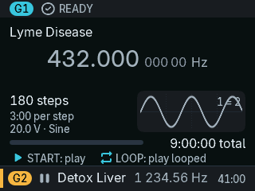 |
| Running: frequency, step, time left, scope, next frequency, G2 in the strip | Ready: program summary and key chips |
| 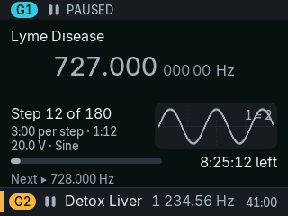 | 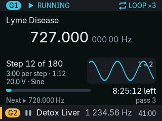 |
| Paused | Repeat on, third pass |
| 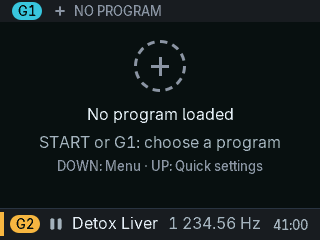 | 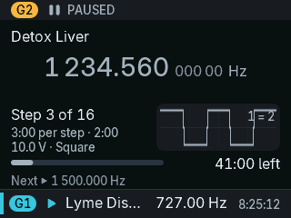 |
| No program loaded | G2 focused, G1 in the strip |
| 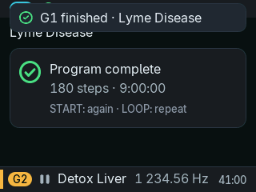 | 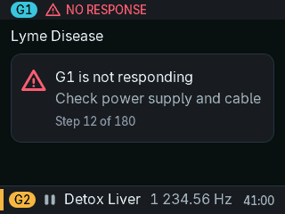 |
| Program complete | Generator not responding |
| 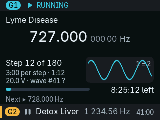 | 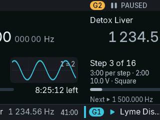 |
| "wave #41 ?": a stored waveform table | A frame of the slide from G1 to G2 |
|  |  |
| "Stop after" timer: minutes left in the status bar | A chain: "Chain 2/3" in the status bar |

### Program list, program detail, slot actions

| | |
|---|---|
| 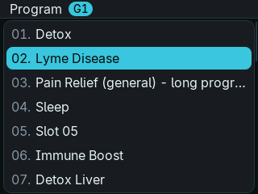 | 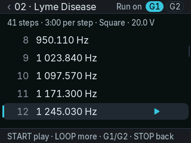 |
| Program list, target G1 | Program detail, the playing step marked |
| 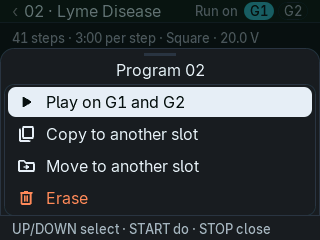 | 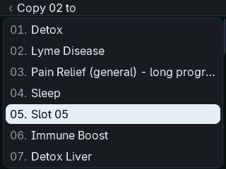 |
| Slot actions (program detail > LOOP) | "Copy 02 to": the first empty slot selected |

### Menu, timers, history, diagnostics

| | |
|---|---|
|  | 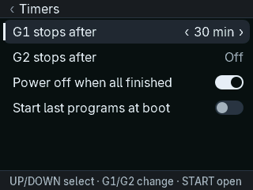 |
| Menu (DOWN) | menu > Timers |
| 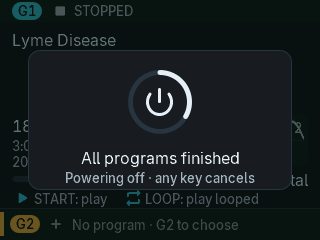 | 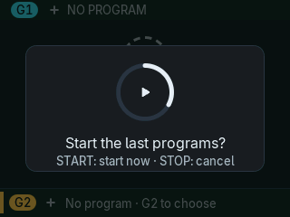 |
| Power off when all finished: the 15 s card | Auto-start at power-on: the 10 s card |
| 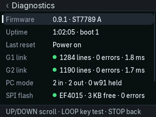 | 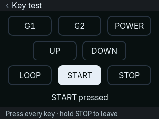 |
| Diagnostics | Key test |

### Chains and plans

| | |
|---|---|
| 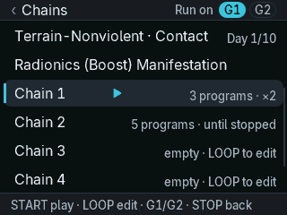 | 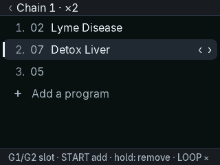 |
| menu > Chains, scrolled down to the chains: the built-in rows first (the six Terrain protocols and the preset), then the chains and plans | Chain editor |
| 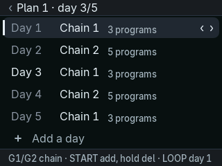 | |
| Plan editor | |

### Terrain Protocol and manual generator

The Terrain shots show the six protocols with the names, days and sets of the image's table
(copied by hand into `src/nx/nxg_core.c`; the gallery does not run the Terrain engine). The
positions in them are examples. The host tests keep their own made-up tables
(`tests/host/nx/terrain_fixture.c`).

| | |
|---|---|
| 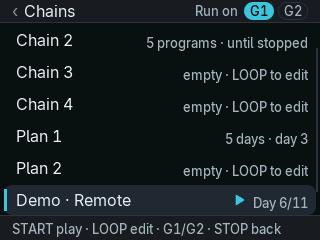 | 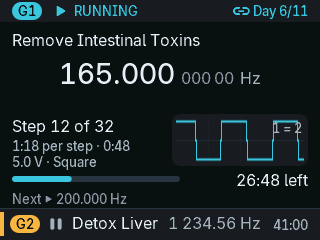 |
| menu > Chains: the Terrain rows first, then the chains | A Terrain set: "Day 6/11" in the status bar (the name is the gallery's sample program) |
| 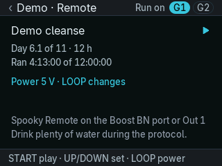 | 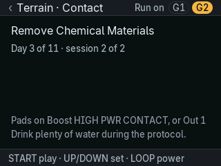 |
| Terrain screen, Remote: day, time run, power | Terrain screen, Contact: day and session |
| 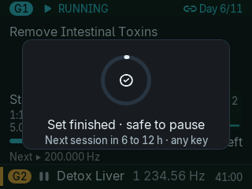 | |
| "Set finished · safe to pause" | |
| 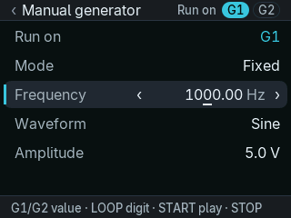 | 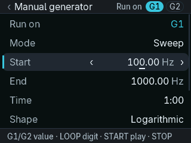 |
| Manual generator, a fixed frequency | Manual generator, a sweep |

### Sheets and overlays

| | |
|---|---|
| 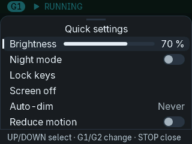 | 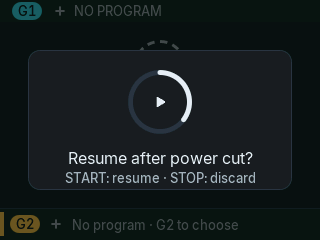 |
| Quick settings (UP) | Resume after a power cut |
| 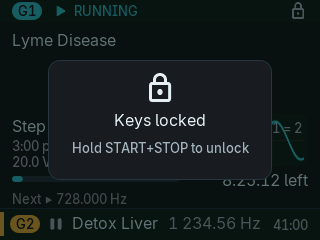 | 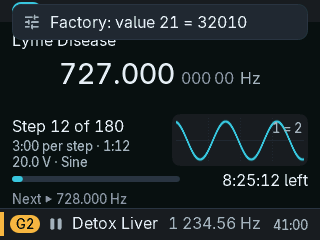 |
| Keys locked | A toast (factory port wrote a value) |
| 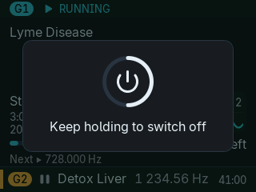 | 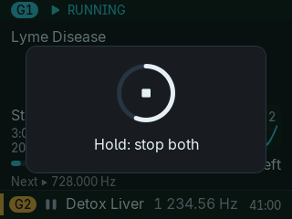 |
| POWER held: switch off | STOP held: stop both |
| 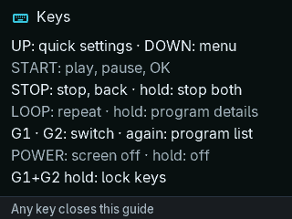 | 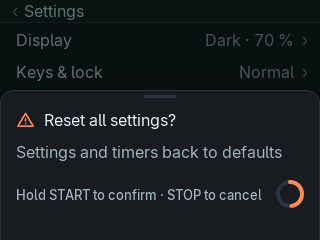 |
| Key guide (first boot, and from Settings) | "Reset all settings?": hold START to confirm |
| 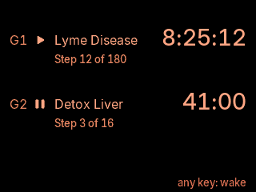 | 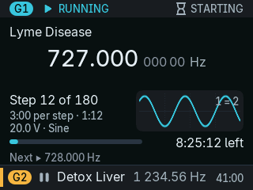 |
| Night view when idle | "STARTING" in the first ~4.4 s |

### Settings

| | |
|---|---|
| 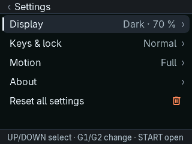 | 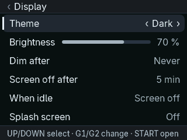 |
| Settings (menu > Settings) | Display |
| 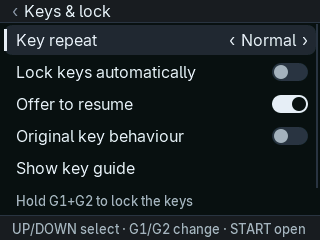 | 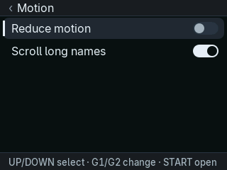 |
| Keys & lock | Motion |
| 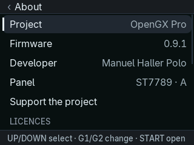 |  |
| About: project, firmware, developer, panel, "Support the project", licences | Support the project: the QR code and the address in words |

### PC mode, calibration, splash, goodbye

| | |
|---|---|
| 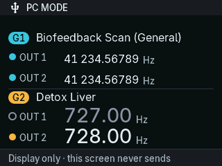 | 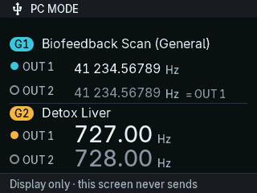 |
| PC monitor: G1 both outputs on, G2 Out1 off | G1 Out2 follows Out1 (sync) |
| 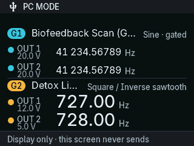 | 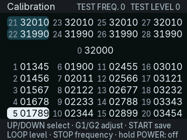 |
| PC monitor: waveforms, amplitudes, gating | Calibration grid |
| 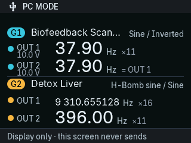 | 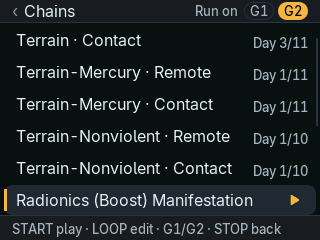 |
| PC monitor: the output frequency of wave tables with 11 and 16 cycles; Out2 the inverse | menu > Chains: the built-in preset, "Radionics (Boost) Manifestation", after the Terrain rows, loaded on G2 |
| 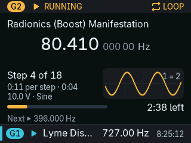 | |
| The built-in preset in a sweep: the output frequency, the next step's start | |
|  |  |
| Splash (the drawn one, black in every theme) | Goodbye |

### Themes

| | |
|---|---|
|  |  |
| Light | High contrast |
|  |  |
| Program list, light | Settings, high contrast |

## 11. Settings

The original has no settings. nx keeps its settings in the SPI flash (section 13). They are
written 3 s after the last key when no generator line is due within 1 s, and never in PC mode.
Defaults from `src/nx/nx_uiset.c` and `src/nx/nx_settings.c`.

| Setting | Where | Values | Default |
|---|---|---|---|
| Brightness | Quick settings; Settings > Display; UP/DOWN in PC mode | 10–100 % in steps of 10 % | 70 % (about the light of the original's fixed 50 % duty) |
| Night mode | Quick settings | on / off (night palette) | off |
| Theme | Settings > Display | Dark, Light, High contrast | Dark |
| Dim after | Settings > Display; Quick settings "Auto-dim" | Never, 30 s, 1, 2, 5, 10 min | 1 min |
| Screen off after (after dimming) | Settings > Display | Never, 1, 5, 15, 30 min | 5 min |
| When idle (after "Screen off after") | Settings > Display | Screen off, Night view (night palette, 3 % backlight, both generators, one update per second) | Screen off |
| Splash screen | Settings > Display | Off, Short, Full | Full |
| Key repeat | Settings > Keys & lock | Slow, Normal, Fast (first repeat after 600 / 400 / 300 ms, then every 180 / 110 / 70 ms, every 50 ms once held 1.5 s) | Normal |
| Lock keys automatically | Settings > Keys & lock | on / off (10 s after the last key while a generator runs) | off |
| Resume after power cut | Settings > Keys & lock | on / off | on |
| Original key behaviour | Settings > Keys & lock | on / off (section 9.11) | off |
| Reduce motion | Quick settings; Settings > Motion | on / off | off |
| Scroll long names | Settings > Motion | on / off | on |
| G1 stops after, G2 stops after | menu > Timers | Off, 5, 15, 30, 45, 60, 90, 120, 180, 240 min | Off |
| Power off when all finished | menu > Timers | on / off | off |
| Start last programs at boot | menu > Timers | on / off | off |

Actions without a stored value: Quick settings > Lock keys, Quick settings > Screen off,
Settings > Keys & lock > Show key guide, Settings > Reset all settings (the confirmation says
"Settings and timers back to defaults"; hold START 1 s to confirm; every setting above back to
its default, the timers and auto-start included).
Settings > About shows the rows Project ("OpenGX Pro", `NX_PRODUCT` in `src/nx/nx_config.h`),
Firmware (the version, "0.9.0", `NX_FW_VERSION`), Developer ("Manuel Haller Polo", `NX_AUTHOR`),
Panel ("ST7789" and the panel type A or B) and "Support the project" (section 9.16), then the
licence lines of the fonts and icons, "Free software without any warranty" and "Not made or
endorsed by the device maker".

## 12. Resume after a power cut

New in nx (`src/nx/nx_resume.c`). The original starts with both generators empty after every
power-on.

| Part | How it works |
|---|---|
| What is saved | per generator: slot, running or paused, repeat on/off, position in the program, CRC-32 of the stored program, and the position in a chain or plan. For a Terrain set: the set, its protocol, the power level and the set's running time (section 9.12). The manual generator is not saved |
| When | on each change (slot, run, repeat, chain position) and every 60 s while a generator runs; only when both queues are idle and no step ends within 100 ms; never in PC mode or in the calibration menu |
| Where | the key-value store in the nx SPI-flash area (key 0x0002) |
| The offer | after a power cut or a crash, the dashboard shows "Resume after power cut?" with a ring that fills in 15 s |
| Keys | START resumes now; STOP discards; a full ring resumes by itself; other keys do nothing (POWER works) |
| Result | each generator continues at the saved position (at most one minute back); a paused one stays paused; repeat is kept; a chain, plan or Terrain protocol goes on from its saved position |
| History | with History built in, the snapshot also becomes a "power cut" record (section 9.5) |
| Not offered | after a clean power-off (POWER held); after both generators were stopped; after a PC session; if the slot's program changed; when the setting is off; in safe mode after a boot loop |
| Setting | Settings > Keys & lock > "Resume after power cut" (default on) |
| Auto-start | a different offer at a normal power-on (section 9.4); a resume offer wins |
| Tests | host: `tests/host/nx/test_nx_resume.c`; device: `docs/nx/drop1-checklist.md` §6 (still to do) |

## 13. Storage

nx writes its own data only in 0x080000–0x1FFFFF and never in PC mode. The original never uses
that area. The one exception is slot copy / move / erase (section 9.6): it writes the legacy
program and name areas through the shared storage code, as a Spooky2 upload does, never in PC
mode. Everything else in the legacy areas is handled only by the shared `storage.c`, exactly as in
the original.

| SPI-flash area | Content | Written by | Kind |
|---|---|---|---|
| 0x05000 | program names (32 × 60 bytes) | `:n` uploads, `w96`; slot copy / move / erase | Same |
| 0x10000 + n·0x1000, n = 1…30 | programs and step parameters | `:p`, `:nNN=,`, `w96`; slot copy / move / erase | Same |
| 0x74000, 0x75000 | calibration and its backup | calibration menu, `w62`, `w63`, factory port | Same |
| 0x080000, 0x081000 | nx superblock, copies A and B (the higher valid one wins) | nx | New |
| 0x082000 | key-value log, two pages of 16 KB: settings (key 0x0001), resume snapshot (0x0002), last programs for auto-start (0x0003), chains (0x0004), history totals (0x0005), plans (0x0006), Terrain positions (0x0007), manual generator values (0x0008) | nx | New |
| 0x090000–0x09FFFF | journal, reserved in the superblock, unused | – | – |
| 0x0A0000–0x0BFFFF | history ring: 32 sectors, 2,048 records of 64 bytes | nx | New |
| 0x0C0000–0x1FFFFF | reserved in the superblock, unused | – | – |

Also: the crash record lives in RAM at 0x20007000 (256 bytes, `.noinit`). nx only reads the
internal flash at 0x08003C00 (panel variant). The bootloader area 0x08000000–0x08003FFF is never
written.

## 14. What a Spooky2 user will notice

1. POWER pressed briefly switches the screen off. It no longer stops both generators. To stop
   both, hold STOP for 1 s, then release. Settings > Keys & lock > "Original key behaviour" gives
   back the original's POWER, START and LOOP.
2. LOOP while a program runs only switches repeat on or off. It does not pause (unless "Original
   key behaviour" is on).
3. Steps are exact: a 180 s step takes 180 s. The original takes 181.8 s.
4. The splash is short and black, as the original's, and shows the name "OpenGX Pro". In a
   personal build made with `NX_VENDOR=1` from the original image it is the original's ghost
   splash. The generators still start about 4.4 s after power-on, as before.
5. By default the screen dims after 1 minute without a key and switches off 5 minutes later.
   A key wakes it. When the screen is off, the first key only wakes it. The PC screen stays lit.
6. The dashboard shows more: step n of N, time left, next frequency, amplitude, waveform, a scope.
   The frequency is also shown when ready or paused.
7. After a power cut the unit offers to resume.
8. Settings (brightness, theme, …) survive a power cycle.
9. Replies to Spooky2 come faster. In a serial capture, G1 and G2 lines can overlap in time. The
   order on each link is the same.
10. All texts are in English. Name bytes outside printable ASCII show as "?".
11. The goodbye screen is shorter and has no QR code.
12. G1+G2 held 1.5 s locks the keys. Hold START+STOP 1.5 s to unlock.
13. DOWN opens a menu: Programs, Chains, Manual, Timers, Diagnostics, Settings.
14. The PC screen also shows the waveforms and amplitudes the PC set, for both outputs.
15. Programs can be copied, moved and erased on the device. The slots then hold them as after a
    Spooky2 upload.
16. The Terrain Protocol runs without the PC: its six rows are the first of menu > Chains. A
    Contact session ends with a card and three backlight pulses; nothing beeps.
17. menu > Manual plays a frequency or a sweep by hand, with a waveform and an amplitude.
18. A chain now switches the waveform and the amplitude with each program.
19. With a Spooky2 preset that uses a Wave Cycle Multiplier, the PC screen shows the frequency
    Spooky2 shows, with the multiplier ("396.00 Hz ×11"). The original shows it divided (36 Hz).
20. A Spooky2 preset with sweeps can run without the PC (menu > Chains, after the Terrain
    rows): "Radionics (Boost) Manifestation".
21. The first time after power-on (or after the PC, or after that preset) that menu > Manual or a
    Terrain set plays a sine, it starts about half a second later: nx puts Spooky2's standard sine
    into the generator first, so "Sine" is a sine whatever a preset left there. (The Terrain sets
    of the committed table play the square and the inverse sawtooth, none the sine.)

## 15. Restored after the size cut

These features were cut on 2026-09-24 to fit the proven image size and put back on 2026-09-25.
They are built and tested (host tests, screen gallery, emulator gates). With them the image was
77,372 bytes; that image was flashed and runs on the device (2026-09-25). The features of
section 9 came later (section 17).

| Feature | Where | Kind |
|---|---|---|
| Key guide (7 key explanations) | after the first boot; Settings > Keys & lock > "Show key guide" | New |
| Licence lines on the About page: Inter / SIL OFL 1.1, Material Symbols / Apache 2.0, "Free software without any warranty", "Not made or endorsed by the device maker" | Settings > About | New |
| "Reset all settings" (every setting to its default), confirmed by holding START | Settings | New |
| Night idle view instead of a black screen | Settings > Display > "When idle": Screen off (default) / Night view | New |
| Key-hint bar at the bottom | Settings, quick settings, the menu, program detail, the new pages, PC monitor ("Display only · this screen never sends"); not on the program list, which keeps the original's 7 rows | New |
| Splash lines "Open firmware for the GeneratorX Pro" (at the time: "Open firmware GX Pro"), the version, "any key: skip" | the drawn splash (the ghost splash keeps the version and "any key: skip") | New |
| Goodbye line "This session h:mm:ss" | goodbye | New |
| Calibration title, "TEST FREQ." / "TEST LEVEL" readout, two key-help lines | calibration | New |
| "…" at the end of texts that do not fit (instead of cutting them at the edge) | everywhere | New |
| Back arrow "‹" in page titles | settings pages, the new pages and the program detail (not the program list: the original list has none) | New |
| Dashed ring above "No program loaded" | empty dashboard | New |
| "STARTING" in the status bar and a "Generators are starting…" toast in the first ~4.4 s (without them, a key in that time silently does nothing) | dashboard | New |
| Confirmation toasts: "G1 stopped", "Both generators stopped", "Repeat on" / "Repeat off", "Program NN loaded on G1", "G1 finished · name", "PC disconnected" | dashboard, program list, PC mode exit | New |

## 16. Not included

### Still cut (not in nx)

| Feature | Note |
|---|---|
| Large 22 px title font | names and titles use the 16 px font |
| Generator options sheet | LOOP held opens the program detail instead |
| Step and duration columns in the program list | the list shows "NN. name", as the original |
| German language | English only |
| Independent Out2 | Out2 follows Out1 inverted, in programs, Terrain sets and the manual generator. A built-in preset sets Out2's table and offset as its Spooky2 preset does (section 9.17) |
| Toast when START / STOP / LOOP are pressed in PC mode | the keys do nothing, silently, as in the original |

The menu grid and the Diagnostics page with the key test were cut earlier; they are back
(sections 9.1, 9.2). The manual frequency and sweeps are done since 2026-09-25 (section 9.14).

### Not possible

| Feature | Why |
|---|---|
| Sweeps in programs loaded from Spooky2 | Spooky2 keeps only a sweep's start frequency when it uploads to the GX slots; a slot holds one dwell and at most 200 steps. Sweeps come from the manual generator (section 9.14) or from the built-in preset (section 9.17) |
| An audible alert | the board has no buzzer; the set-end alert is visual (section 9.13) |

### Cancelled

| Group | Features |
|---|---|
| Drop 3 | Spooky2 presets other than Terrain, favourites / recent, archive. Back since 2026-09-25: chains, multi-day plans, on-device slot copy / erase (section 9), the Terrain Protocol standalone (section 9.12). Back since 2026-10-05: one Spooky2 preset with sweeps (section 9.17). Both in personal builds only until 2026-10-13, built in by default since |
| Drop 4 | independent Out2, amplitude cap, waveform uploads, dual mirror, program inspector. Back: usage statistics, as the History totals; the manual generator and sweeps (section 9.14); the two wave tables of a built-in preset (section 9.17) |
| Rest of Drop 2 | the `#` side channel and `nx_ctl.py`. Back: history, session timer, auto-start, diagnostics, a richer PC monitor (it reads the PC's waveform, amplitude and gating) |
| Backlog | on-device biofeedback scan, RTC |

## 17. Limits and open points

| Topic | State |
|---|---|
| Image size | Now (2026-10-13), OpenGX Pro 0.9.0: the image is 108,456 bytes (`gxpro.bin`, the figure `tools/release_check.py` prints) of the 112,640 the vendor bootloader is proven to take: **4,184 bytes are left**. The default build (`make APP=nx`) and the released image (`make release`) are this size: both hold the Terrain table and the preset table (committed in `src/nx/data/`, made from Spooky2's presets) and no vendor splash, so nothing from the original image; History and the 48 px digits stay off by default. Without the two tables (`NX_TERRAIN=0 NX_PRESETS=0`) the image is 102,876 bytes; without the Terrain table only 104,084, without the preset table only 107,248. Before the tables were committed (earlier on 2026-10-13) `make release` built without them, 102,860 bytes with 9,780 left, and a personal build with them was 108,448 bytes with 4,192 left. The build budget is 112,640 bytes (110 KB, `NX_FLASH_LIMIT` in `ld/nx.ld`), the size the vendor bootloader is proven to take (`FLASH_PROVEN`, size test of 2026-09-25, `docs/nx/drop0-checklist.md` §1: 96, 104 and 110 KB all arrived byte for byte); `make flash` refuses a larger image. Earlier measurements, all of builds with the Terrain data and the preset: on 2026-10-06 the image was 106,538 bytes (`gxpro.bin` 106,544 bytes) with 6,102 left. Until 2026-10-05 the image was 112,586 bytes with 54 left; then three things went off by default to make room (what each feature, font, icon and text costs: `docs/nx/drop1-size-inventory.md`): the ghost splash (2,264 bytes; `NX_VENDOR=1` builds it in), History (2,120 bytes; `NX_FEAT_HIST=1`) and the 48 px frequency digits (2,008 bytes; `NX_FEAT_HERO48=1`). The rework of the PC monitor's extras took 344 bytes of that room, so any two of the three fit again, but not all three (112,930 bytes, 290 over; measured at the 106,538-byte image, not again since). Measured on 2026-10-06 (`gxpro.bin`): 105,336 without the preset's data (`NX_PRESETS=0`), 104,160 without presets and the standard sine (`NX_FEAT_PRESET=0`); 103,276 without the manual generator (`NX_FEAT_MANUAL=0`); 102,172 without the Terrain data (`NX_TERRAIN=0`); 93,196 without chains, plans, Terrain and presets (`NX_FEAT_CHAINS=0`). The MCU has 128 KB of flash: the first 16 KB are the vendor bootloader (never touched), 112 KB are the application region. The update file is the image padded to 16 bytes plus a 4-byte ID (the released one, `opengx-pro-0.9.0.bin`: 108,468 bytes in 53 blocks; on 2026-10-06: 106,548 bytes). To make the image smaller, switch features off (`NX_FEAT_*` in `src/nx/nx_config.h`, `NX_TERRAIN=0`, `NX_PRESETS=0`). |
| Device test | the 77,372-byte image with the new UI runs on the device, and Spooky2 on both generators in PC mode passes (`docs/nx/drop1-checklist.md` §8 step 2). Resume, the features of section 9, the black splash, the Terrain Protocol and the manual generator have not been on the device yet (checklist §6, §9–§25). |
| Waveform tables 11–19 standalone | the manual generator and the Terrain sets play them standalone. Not checked on the device yet: the original only ever plays tables 41–70 standalone (checklist §21). |
| Generator wave tables 11–25 | Spooky2 uploads them at every preset load (13 tables in the capture of 2026-10-05), with what that preset needs: after a preset with a Wave Cycle Multiplier of 11, table 11 holds 11 sine cycles at half scale. They stay in the generator; a built-in preset (section 9.17) leaves tables 11 and 25 the same way. **The sine is covered:** before the manual generator or a Terrain set plays table 11, nx uploads Spooky2's standard sine there, once per power-on, PC session or preset (section 9.17, "After it"). Not covered: the other waveforms (tables 12–19: square, sawtooth, …) play as the last Spooky2 preset left them; a stored slot that names table 11 itself. Whether the tables survive a power-off is not known; nx assumes nothing and uploads the sine again after every power-on. |
| Presets with sweeps | one preset, built into every image since 2026-10-13, the released one included (`NX_PRESETS=0` builds without it). Not checked on the device: whether the generators take a wave table from the display (if not: the preset stops with a toast; the manual generator's and the Terrain sets' sine play as before, after one wait of 2 s per power-on), and the output on a scope (checklist §28). Spooky2 keeps `:w15=1,1,` during its sessions; standalone it is `0,0` (the display sends that when PC mode ends): if the output differs from a Spooky2 run, that is the first thing to try. The dashboard's scope shows "1 = 2" though Out2 is the inverse. LOOP on its row does nothing though the hint bar offers "LOOP edit". After STOP, START plays it once. |
| Terrain Protocol | built into every image since 2026-10-13, the released one included (`NX_TERRAIN=0` builds without it). Not checked on the device (checklist §23, §24). Its sets play the tables 12 and 14 (square, inverse sawtooth), which play as the last Spooky2 preset left them (the row "Generator wave tables 11–25"). Contact sets play with Out2 following Out1 inverted; the Contact shell's Out2 carrier, its amplitude ramps and its low-frequency amplitude reduction are not reproduced; the Remote time counts running time only (`DEVIATIONS.md`, "nx"). |
| Manual generator | not resumed after a power cut, not auto-started. Out2 follows Out1 inverted. A sweep sends a new frequency every 125 ms at most, and less often while the link is busy. |
| Language | English only; there is no language setting. |
| Waveform tables 41–70 | the display cannot see their shape: "wave #N ?" and a sine as a stand-in (section 7). |
| Hardware values of Drop 0 | safe defaults until measured (`docs/nx/drop0-checklist.md`), e.g. the RAM area of the crash record and the backlight PWM frequency. |
| Resume | goes back at most one minute; not offered after a PC session or when the slot's program changed. |
| PC monitor | names, four frequencies, outputs on/off and sync from the protocol core; waveforms, amplitudes and gating from the receive tap. A waveform number the display does not know shows as "#N" (20, 21: Spooky2's user-defined shapes). Gating is per generator, not per output. The cycles of a wave table come from its crossings of the middle: a table with fewer than three crossings on a grid (an H-Bomb table with a Wave Cycle Multiplier under 6), or a shape that crosses the middle more than once per cycle, shows the wire value. Not shown, though Spooky2's own output pane has them: offset, duty cycle, phase, measured current and angle (the list below) |
| MCU temperature and supply | from the chip's factory calibration and the datasheet slope; not checked against a thermometer or a meter. The chip reads a few degrees above the room. |
| History (when built in) | no clock: a session number and the uptime instead of a date. The screen lists the newest 255 runs (the ring keeps up to 2,016 readable). Runs per slot and the session count are kept but not shown. A "power cut" record needs "Resume after power cut" on; it carries the program position of the last snapshot as its time and the session of the boot that found it. |
| Chains and plans | a chain plays each program once (repeat off), with its own waveform and amplitude (since 2026-09-25, section 9.8). A plan has no clock: the next day starts with START on the plan. A day whose chain repeats "until stopped" never completes. |
| Auto-start | starts the last program of each generator from step 1; it does not restart a chain or plan. A Terrain protocol goes on from its stored position. |

### Checked against Spooky2's guides (2026-10-06)

Spooky2's User's Guide (January 2025) and Quick Guide V1.3, chapter "GeneratorX Pro". "Original"
is the vendor firmware.

What the guides confirm:

| The guides say | nx |
|---|---|
| Standalone: G1 or G2 opens the program list, UP/DOWN choose, START selects and returns to the main screen ("Ready"), START again plays, LOOP plays continuously with a loop icon top right, STOP stops; STOP in the list goes back | the same flow (sections 6, 8) |
| "If you press Start or Loop while a program is running, it will pause" | START pauses. LOOP only switches repeat; "Original key behaviour" gives the original's LOOP back (section 6) |
| Status icons Running, Stopped, Paused, Looping; the port number on the generator's screen ("4 - Stopped") | the same states; the port text is the name Spooky2 writes into slots 0 and 31, shown on the PC monitor |
| 30 offline programs, 200 frequencies per program, 20 V peak to peak at most, 0.01 V steps, 0–40 MHz, 115200 baud | the same limits (30 slots, 200 steps; the manual generator 0–20 V, 0.01 Hz – 40 MHz) |
| An offline program keeps Frequency, Waveform, Amplitude, Offset, Duty Cycle, Gate and Dwell; no chains, no sweeps, no repeats | nx plays a slot with the same lines as the original (waveform and duty cycle are in the wave table 40 + slot, the gate in the `:g` pairs). Chains and sweeps are nx's own (sections 9.8, 9.14, 9.17) |
| Load, Copy, Paste, Erase, Reset and the calibration buttons of the Control tab; "Turn GX displays OFF / ON" | they use the display's serial commands, which are the shared protocol core: `:g`, `:p`, `:n` for Load (seen in serial captures of Spooky2); erase all (`:w96`), restart (`:w95`), calibration (`:w60`…) and display on / off (`:w64`) from the spec. Which button sends which was not captured for Copy, Paste, Erase and Reset |
| Biofeedback scans "cannot be performed standalone" | none in nx either |
| Waveforms 1–11: Sine, Square, Sawtooth, Inverted sawtooth, Triangle, Damped sinusoidal, Damped square, Sine H-Bomb, Square H-Bomb, User defined #1, #2 | tables 11–21 in this order; 18 / 19 were named wrongly until 2026-10-05 |
| Damped and H-Bomb waves are made of several inner cycles (Wave Cycle Multiplier 8 and 16 by default) and "Spooky2 automatically compensates … so that their output frequencies are always correct"; the H-Bomb is flat, one full cycle, six small ones, one full cycle, flat | the PC monitor's "×N" for these tables (section 9.7) |
| Amplitude is peak to peak; with a 100 % offset a "20 V" setting gives 10 V peak to peak | the PC monitor and the dashboard show the value sent (section 9.7; nx's rule of 2026-10-05 was wrong) |
| The Terrain preset "will run non-stop, then repeat"; stop it after 11 days | the Remote protocol repeats from day 1 (section 9.12) |
| "Notify When Zero Hz": a sound when a set ends and it is safe to pause | the set-end card (section 9.13; no buzzer) |

What nx does not do, or does differently:

| The guides say | nx | Kind |
|---|---|---|
| The USB icon is red for "USB is connected" and white for "GX Pro detected by Spooky2" | one USB icon in PC mode: the display does not tell whether Spooky2 has found the generator (`DEVIATIONS.md`: the `w91` handshake is accepted, the icon always "unlocked") | Open, against the original |
| Reset: "The generator will power off after resetting" | if Reset is `:w95`, nx restarts the display MCU as the original does; whether the unit then switches off was not checked on the device | To check |
| Spooky2's output pane shows per output Frequency, Waveform, Duty Cycle, Amplitude, Offset, Phase Angle, VI Phase and Current | the PC monitor shows frequency, waveform, amplitude, gating, sync and on/off. Not shown: offset (`:w32`/`:w33`), duty cycle (in the square's wave table), phase, the measured current and angle (the generator's answers to `:r11`/`:r12`). The original's PC screen shows only the frequencies | Open, beyond the original |
| Waveform labels "Inv Sawtooth", "Sine Damped", "Square Damped", "Sine H-Bomb", "Square H-Bomb", "Inverse+Sync", "User defined #1" | "Inverse sawtooth", "Damped sine", "Damped square", "H-Bomb sine", "H-Bomb square", "Inverted", "#20" | Open, wording |
| The amplitude with two decimals ("10.12v") | one decimal ("10.1 V") | Open, wording |
| "Modulate Out 1" (GX Pro only: Out 2 modulates Out 1's amplitude) | not shown; its serial command is not known (`:w13`, `:w15`, `:w40` are sent by Spooky2 and not understood) | Open |
| Contact presets: the amplitude ramps up and down (4 V/s) and is reduced below the "Reduce Amplitude" frequency. The guide's screenshots fit half the amplitude at 0 Hz rising in a line to the full one at the limit, if the limit was the default 10 kHz: 10.05 V at 47 Hz and 10.12 V at 125 Hz for a 20 V preset. The GX shell says "GX does not provide amplitude ramping in offline mode. You may feel spikes" | the Terrain Contact sets play their 20 V at once and at every frequency (as an offline program on the original) | Open, beyond the original |
| Gating, Out 2 with its own frequency (factor, constant, carrier), wobble, spikes, spectrum, phase | slots keep what Spooky2 stored (gate pairs, the wave table). The manual generator, the Terrain sets and the built-in preset have none: Out2 is Out1 inverted | Open, beyond the original |
| On the PC: Hold, jump to a step or start at another one, change the dwell while paused, adjust the frequency; run from–to, run for N hours, start later | play, pause, stop, repeat, "stop after N min". No hold, no skip to another step, no clock | Open, beyond the original |
| Frequency resolution 0.00000001 Hz, amplitude 0.01 V | slots play any stored value; the manual generator sets 0.01 Hz and 0.1 V steps | Open |

Found on the way, not in the guides:

| Finding | State |
|---|---|
| The wave table of a stored program (40 + slot) is in the generator board that received the upload: Spooky2 sends `:a41=…` only on the port it loads through, while the 30 slots are one list for both generators. A program loaded through G2's port plays on G1 with whatever G1's table holds. The original has the same; nx makes it easier to meet ("Play on G1 and G2", chains on either generator) | Open: nx could note per generator which tables it saw uploaded and warn |
| A copied or moved program (section 9.6) keeps the table number of its source slot. A later upload into the source slot changes the copy's waveform | Open |
| Spooky2 hides the frequencies of its DNA and MW programs on the PC; a stored program's frequencies are readable on the device (the original shows the running one, nx's program detail all of them) | Note |

## 18. How it is verified

| Check | Result | Command |
|---|---|---|
| Host unit tests | 0 failed (`test_nx_assets` 971 checks, `test_link` 19,198, `test_nx` 22,592); Terrain, the manual generator and the presets in `test_nx_terrain.c`, `test_nx_manual.c`, `test_nx_preset.c` | `make -C tests/host` |
| Classic build | `APP=fw` stays byte-identical | `make` |
| Classic build against the original, on the emulator | 18/18 scenarios | `.venv/bin/python tools/diff.py --jobs 6` |
| nx build | links under the 112,640-byte budget (110 KB): 108,456 bytes with the two committed tables (the default), 102,876 without them | `make APP=nx`; `make APP=nx NX_TERRAIN=0 NX_PRESETS=0 BUILD=build/nx-nodata` |
| Release image | 108,456 of 112,640 bytes, 4,184 free; built from scratch, with the Terrain table and the preset table and with no vendor splash: the compiler flags, the map file and the build directory are checked for it (the two tables must be linked, nothing made from the original image may be), and the update file (108,468 bytes) must be the image encoded with its ID | `make release` |
| nx builds without and with features | each `NX_FEAT_*` off on its own, `NX_TERRAIN=0` and `NX_PRESETS=0` build; so do the three that are off by default, each on its own; History and the 48 px digits also together (112,584 bytes, 56 to spare) (`NX_FEAT_HIST=1`, `NX_FEAT_HERO48=1`, `NX_VENDOR=1`) | e.g. `make APP=nx NX_LCD_OPTS=-DNX_FEAT_MANUAL=0 BUILD=build/nx-off-MANUAL`, `make APP=nx NX_TERRAIN=0 BUILD=build/nx-noterrain`, `make APP=nx NX_PRESETS=0 BUILD=build/nx-nopreset` |
| Spooky2 capture on the emulator, PC mode | a serial capture of Spooky2 playing the Radionics preset, replayed on the image: the monitor shows 396.00 Hz ×11 in the fixed step and 3 062.53125 Hz ×11 in the sweep, as Spooky2 (before: 36.00 and 278.41193182 Hz) | `.venv/bin/python tools/pc_replay.py replay CAPTURE --out build/replay/after` (CAPTURE: your own serial capture of Spooky2) |
| Built-in preset on the emulator, against the capture | a build with the preset from before 2026-10-13 (its table then made at build time), started with the keys, sent what Spooky2 sent: both wave tables byte for byte, every generator setting, the first line of each step, 263 sweep lines within 8 ms of Spooky2's line. To be rerun on this image | `.venv/bin/python tools/pc_replay.py standalone CAPTURE --seconds 47` |
| Assets | the string and icon tables match their sources | `make nx-assets-check` |
| Emulator, serial only (nx against the original) | 10/10 scenarios on the release image of 0.9.0 (2026-10-13), `pc_dual_session` included | `.venv/bin/python tools/diff.py --jobs 6 --candidate build/release/gxpro.elf --serial-only --timing one-sided --out build/sim/diff-nx queries serial_storage serial_adversarial serial_maint cal_trim pc_mode boot_home cal_boot power_off pc_dual_session` |
| Emulator, nx keymap | 5/5 scenarios on the release image of 0.9.0 (2026-10-13) | `.venv/bin/python tools/diff.py --jobs 5 --candidate build/release/gxpro.elf --serial-only --keymap nx --timing anchor --out build/sim/diff-nx-intents ch1_program g2_switch upload_run pc_upload_exit nx_keys` |
| UI screens | match the 122 approved baselines (host 122/122, host-dev 86/86). New on 2026-10-05: `pc_monitor_wcm`, `chains_preset`, `dash_preset`, no other baseline changed then. New with 0.9.0 (2026-10-13): `support`; changed with it: `splash_400`, `splash_700`, `splash_1100`, `settings_about`, `confirm_reset`, `diagnostics`, `fade_050`, `fade_150`, `fade_300`. Approved again on 2026-10-13 for the new order of menu > Chains: `chains`, `chains_preset`, `chains_terrain` | `.venv/bin/python tools/nx_gallery.py run --host && .venv/bin/python tools/nx_gallery.py compare --source host`; the same with `--host-dev` and `--source host-dev` |
| Test build with fast time | program time (dwells, Terrain hours; not the manual sweeps) runs faster: one second of dwell is 1000 / `NX_TIME_X` ms, rounded down, so `NX_TIME_X=60` gives 16 ms, 62.5 times faster (a 24 h set in about 23 min). The splash says "TEST: fast time". For device tests only: flash the normal build afterwards | `make APP=nx NX_TIME_X=60 BUILD=build/nx-x60` |
| Device: serial conformance (nx core image) | 39/39 replies identical to the original (recorded locally) | `make conformance PORT=<link A> COMPARE=ORIGINAL.json RECORD=NX.json` (ORIGINAL.json: the record of a run on the original) |
| Device: reply time | about 2 ms (original 27–30 ms), recorded locally | `.venv/bin/python tools/gx_latency.py --save FILE.json` |
| Device: the 77,372-byte image (new UI) | flashed and runs (2026-09-25); the checklist is still to fill in | `docs/nx/drop1-checklist.md` |
| Device: the current image | to do; the size test is done | `docs/nx/drop1-checklist.md` (§20–§25 for the black splash, the manual generator and the Terrain Protocol; §27 for the PC monitor's output frequency; §28 for the built-in preset and the standard sine after it) |
| Recovery | the original can always be flashed back | `make flash-original` |
